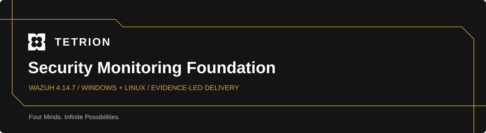
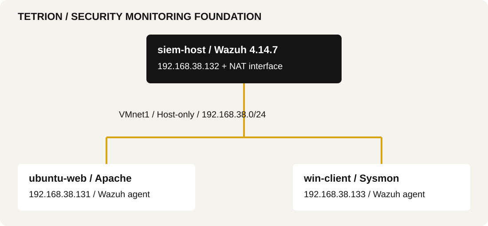

<p align="center"></p>

# Automated SOC Workflow

An evidence-led security monitoring project prepared for **Tetrion**: Wazuh 4.14.7, Windows and Linux endpoint enrollment, Sysmon installation and an Apache web service. This repository presents the recorded implementation, the operating procedure and the checks still needed for acceptance.

**[Read the executive report](reports/Tetrion-Security-Monitoring-Report.pdf)** · **[Editable Word report](reports/Tetrion-Security-Monitoring-Report.docx)** · **[Architecture](architecture/README.md)** · **[Acceptance matrix](docs/acceptance.md)**

## Implementation at a glance

| Component | Recorded state | Evidence |
| :--- | :--- | :--- |
| Wazuh manager, indexer and dashboard | Version **4.14.7**; three containers Up | [E18](evidence/screenshots/image18.png) |
| Windows endpoint | `win-client` · `192.168.38.133` · agent 4.14.7 Active | [E23](evidence/screenshots/image23.png) |
| Linux endpoint | `ubuntu-web` · `192.168.38.131` · agent 4.14.7 Active | [E26](evidence/screenshots/image26.png) |
| Windows process telemetry | Sysmon 15.22 installed; service Running | [E11](evidence/screenshots/image11.png) |
| Linux web service | Apache Running; default page opens | [E13](evidence/screenshots/image13.png), [E14](evidence/screenshots/image14.png) |
| Internal connectivity | All six directed peer tests show replies | [E08–E10](evidence/README.md) |



The diagram represents the supplied deployment evidence. The monitoring server also has NAT access. Final endpoint routing, persistent static addressing and the recovery controls require additional evidence. **Active agents do not by themselves prove delivery of all required security events.**

## Repository guide

```text
architecture/   Recorded diagram, addresses and resource variances
assets/         Tetrion branding and report preview
docs/           Operating procedure, acceptance matrix and event register
evidence/       29 original screenshots, captions and SHA-256 manifest
reports/        Professional PDF and editable DOCX
scripts/        Report builder and artifact verification
profile/        Prepared GitHub profile README and account settings guide
journal.md      Retrospective implementation record grounded in evidence
```

## Start and stop the environment

The original implementation runs in VMware VMs, **not in this repository's cloud container**. This repository contains documentation and report-generation tooling; it does not contain a deployable copy of the original VMs or the local credential-bearing Wazuh configuration.

1. Start `siem-host`. Confirm the internal address and the indexer kernel prerequisite.
2. In the existing Wazuh deployment directory (recorded as `/root/wazuh-docker/single-node`), run `docker compose up -d`, inspect `docker compose ps`, and troubleshoot startup using service logs.
3. Open the configured HTTPS dashboard from the operator workstation. Verify login and index availability.
4. Start `ubuntu-web` and `win-client`. Check Apache, Wazuh agent services and Sysmon64; verify both agents Active and search for a fresh test event.
5. To shut down, stop endpoint workloads and shut down the endpoints first. Run `docker compose stop` on `siem-host`, then shut down that VM. Preserve the data volumes.

The [operations guide](docs/operations.md) includes readiness checks, safe lifecycle commands and the outstanding restart/reboot acceptance test. These are documented procedures, not claims of newly executed VM tests.

## Event path

1. An endpoint produces a configured operating-system or application event.
2. The Wazuh agent reads that source and forwards the event to the manager.
3. The manager decodes the event and evaluates rules; matching events produce alerts.
4. Filebeat forwards alert records to the Wazuh indexer.
5. The dashboard queries indexed data for analyst investigation.

SIEM centralizes event analysis. EDR focuses on endpoint detection and response. XDR correlates across multiple security domains. Wazuh supplies endpoint monitoring and centralized analysis; the actual visibility depends on the sources and rules configured. This deployment's recorded coverage is narrower than a fully validated response workflow.

## Controlled-event acceptance

No rule description, level or screenshot for these five deliberate events is present in the supplied implementation document. They remain **unverified**, with a [capture register](docs/event-validation.md) ready to complete.

| Event | Rule description | Level | Screenshot |
| :--- | :--- | :--- | :--- |
| Failed SSH login | Not recorded | Not recorded | Not supplied |
| Command run with sudo | Not recorded | Not recorded | Not supplied |
| Linux local-user creation | Not recorded | Not recorded | Not supplied |
| Windows process launch through Sysmon | Not recorded | Not recorded | Not supplied |
| Failed Windows logon | Not recorded | Not recorded | Not supplied |

## Resource and recovery records

| Wazuh container | Idle memory |
| :--- | :--- |
| `wazuh.manager` | Not measured in supplied evidence |
| `wazuh.indexer` | Not measured in supplied evidence |
| `wazuh.dashboard` | Not measured in supplied evidence |

Run `docker stats --no-stream` at idle and retain the output. Stack restart/reboot persistence, default-password rotation, snapshot names `w1-clean-install` / `w1-done`, and the Windows evaluation expiry date are also **not documented**. The complete [acceptance matrix](docs/acceptance.md) maps every baseline requirement to evidence or a specific remaining action.

## Build the report

Python 3.11+ and DejaVu Sans fonts are required. On Debian/Ubuntu the font package is `fonts-dejavu-core`. Use a local virtual environment; keep dependency caches and generated work out of tracked source.

```bash
python3 -m venv .venv
.venv/bin/python -m pip install -r scripts/requirements.txt
.venv/bin/python scripts/build_report.py
.venv/bin/python scripts/verify_artifacts.py
```

The PDF is the fixed-layout master. The DOCX is editable and can paginate differently across Word versions. Screenshots keep their original pixels and aspect ratio in equal-size frames; enlargement cannot restore detail that was never captured. [Source notes](docs/source-notes.md) explain the design and evidence handling.

## Repository hygiene

No credentials, private keys, certificate files, live Compose secrets or VM disk images are included. [.gitignore](.gitignore) excludes common sensitive and generated files; it is a safeguard, not proof that every future commit is safe. The current artifact check validates the screenshot hashes, report references, embedded image dimensions and tracked-file patterns. Review new evidence for visible secrets before publishing.

## References

- [Wazuh single-node Docker deployment](https://documentation.wazuh.com/current/deployment-options/docker/wazuh-container.html)
- [Docker Engine on Ubuntu](https://docs.docker.com/engine/install/ubuntu/)
- [Microsoft Sysmon](https://learn.microsoft.com/en-us/sysinternals/downloads/sysmon)
- [SwiftOnSecurity Sysmon configuration](https://github.com/SwiftOnSecurity/sysmon-config)

Prepared by **Roman Rzayev** for **Tetrion**. Four Minds. Infinite Possibilities.
