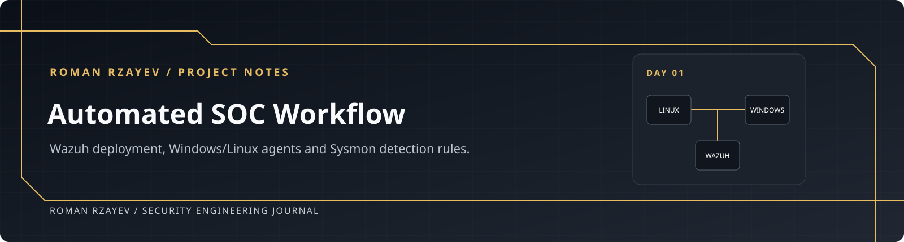

<p align="center"></p>

# Automated SOC Workflow

I’m documenting my SOC setup here: the network, Wazuh deployment, endpoint telemetry and custom rules. Each day includes commands, configuration, results and issues still to resolve.

**Roman Rzayev**

<p align="center"><a href="days/day-01#step-01"><strong>Open Day 01 walkthrough →</strong></a> &nbsp; · &nbsp; <a href="days/day-01#step-12">Read the custom rules</a> &nbsp; · &nbsp; <a href="days/day-01/evidence">Inspect the evidence</a></p>


## Daily notes

| Day | Build focus | Read it here | Evidence status |
| :--- | :--- | :--- | :--- |
| **01** | Monitoring foundation · Wazuh · Sysmon · Windows/Linux | **[Commands, full configurations & explanations](days/day-01/README.md)** | Platform and selected alerts recorded; acceptance checks tracked |

New work will be added under the next day’s folder.

## Day 01 · Wazuh setup


| Foundation | Platform | Endpoints | Detection |
| :--- | :--- | :--- | :--- |
| Host-only topology | Wazuh **4.14.7** | `ubuntu-web` + `win-client` | Sysmon process creation |
| Persistent-IP examples | Three-container single-node stack | Linux and Windows agent procedures | Four full custom XML rules |
| Bidirectional peer tests | Certificate generation and recovery | Apache, SSH and Sysmon | Rule-level result attribution |
| [Network commands →](days/day-01#step-02) | [Deployment commands →](days/day-01#step-06) | [Endpoint commands →](days/day-01#step-08) | [Rules and explanations →](days/day-01#step-12) |

### Check the stack

For example, from the **existing single-node deployment directory on siem-host**:

```bash
sudo docker compose up -d
sudo docker compose ps
sudo docker compose logs --tail=100 wazuh.indexer wazuh.manager wazuh.dashboard
```

<details>
<summary><code>docker compose up -d</code> — explanation</summary>

Starts the services in the background using the existing deployment configuration.

</details>

<details>
<summary><code>docker compose ps</code> — explanation</summary>

Lists the deployment's service containers and their current states.

</details>

<details>
<summary><code>docker compose logs --tail=100 ...</code> — explanation</summary>

Shows recent indexer, manager and dashboard output to inspect initialization or diagnose failures.

</details>

[The Day 01 page](days/day-01/README.md) shows the preceding installation and configuration steps, the remaining commands and their individual expandable explanations.

<details>
<summary><strong>See the recorded endpoint coverage</strong></summary>


The captured inventory lists win-client and ubuntu-web Active on 4.14.7. Full acceptance also requires retained test events, recovery checks and hardening evidence.

</details>

## Reference notes

- **[Complete Day 01 walkthrough](days/day-01/README.md):** commands, configuration and expandable explanations.
- **[Detection results](days/day-01/docs/event-validation.md):** recorded rule IDs, levels, descriptions and gaps.
- **[Evidence register](days/day-01/evidence/README.md):** forty original captures and a source/hash manifest.
- **[Implementation journal](days/day-01/journal.md):** failures, corrections and open actions.
- **[Acceptance matrix](days/day-01/docs/acceptance.md):** the deployment’s remaining validation work.

## Documentation checks

```bash
python3 scripts/build_readmes.py
python3 scripts/verify_artifacts.py
```

Checks screenshot hashes, links, inline configuration, rule expressions and Bash syntax. It does not run the VMware systems or execute PowerShell.

**Roman Rzayev** · [GitHub](https://github.com/romanrzayev1111-png)
