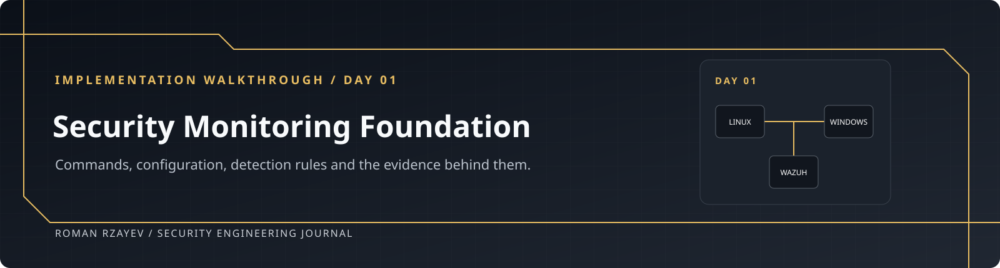
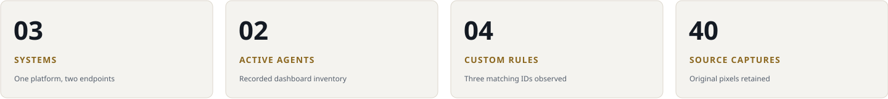
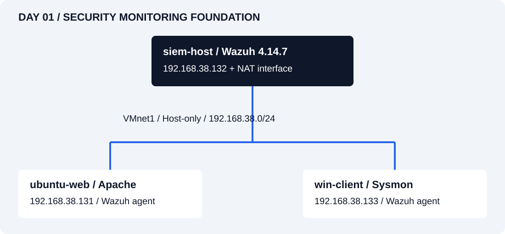
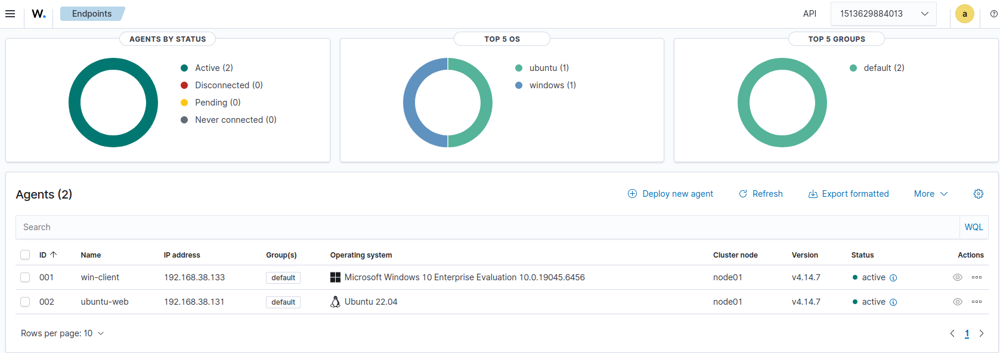
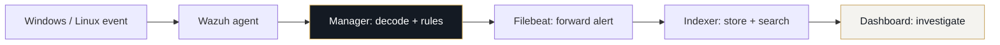
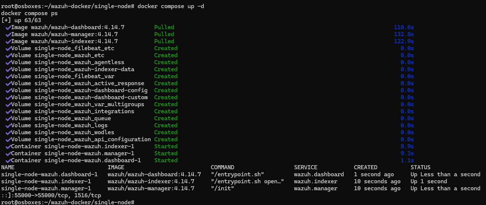
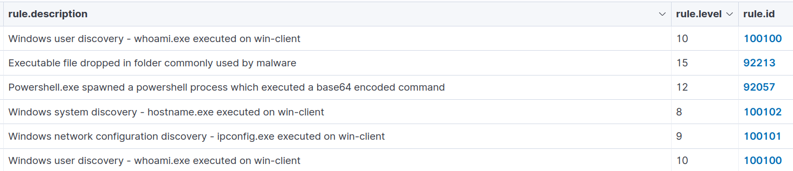

<p align="center"></p>

<p align="center"><strong>Roman Rzayev</strong> · Wazuh 4.14.7 · VMware · Windows + Linux · Sysmon</p>

# Day 01 · Security Monitoring Foundation

Day 01 covers the VMware network, Wazuh installation, two endpoint agents and the first detection rules. Commands and configuration are shown below; expand an arrow when you need an explanation.



| Network | Services and agents | Results |
| :--- | :--- | :--- |
| [01 · Network](#step-01) | [04 · Docker](#step-04) · [06 · Wazuh](#step-06) | [Evidence register](evidence/README.md) |
| [02 · Full Netplan YAML](#step-02) | [08 · Linux agent](#step-08) · [10 · Windows agent](#step-10) | [Event results](docs/event-validation.md) |
| [03 · Peer connectivity](#step-03) | [11 · Sysmon](#step-11) · [12 · Full custom XML](#step-12) | [Acceptance matrix](docs/acceptance.md) |
| [07 · Credential rotation](#step-07) | [13 · Recovery](#step-13) · [14 · Handover](#step-14) | [Implementation journal](journal.md) |

## Environment



| Machine | Address | Responsibility | Run commands as |
| :--- | :--- | :--- | :--- |
| **siem-host** | `192.168.38.132` | Docker, Wazuh manager/indexer/dashboard | Linux administration user with sudo |
| **ubuntu-web** | `192.168.38.131` | Linux agent, Apache, SSH | Linux administration user with sudo |
| **win-client** | `192.168.38.133` | Windows agent, Sysmon, test processes | Elevated PowerShell where stated |

## Results and remaining checks

| Recorded | Still needs acceptance evidence |
| :--- | :--- |
| Three running Wazuh containers and two Active agents | Persistent addressing, final isolation and credential rotation |
| Windows logon failure and three custom discovery IDs | Successful sudo, Linux user creation and full raw-event context |
| Corrected SSH failure plus an alert listing | Restart/reboot persistence, idle memory and snapshot inventory |

<details>
<summary><strong>Open the recorded two-agent dashboard</strong></summary>



E26 shows win-client and ubuntu-web Active on 4.14.7.

</details>

> **Validation:** Results below come from the supplied VM captures. Documentation checks cover source versions, syntax and file integrity; the original VMs were not replayed here.

Check each VM’s interface names and address availability before applying the network examples.

## Event path



The manager evaluates the event; Filebeat forwards the resulting alert to the indexer for dashboard searches.


<a id="step-01"></a>

## 1. VMs and network

**Run on:** VMware host

Use the [recorded inventory](architecture/README.md). The source requirement baseline and the actual allocation differ:

| VM | Baseline RAM / vCPU / disk | Recorded allocation |
| :--- | :--- | :--- |
| siem-host | 16 GB / 6 / 250 GB | 16 GB / 6 / 500 GB |
| ubuntu-web | 2 GB / 2 / 40 GB | 4 GB / 2 / 500 GB |
| win-client | 4 GB / 2 / 80 GB | 4 GB / 4 / 60 GB |

Decide the approved capacity before provisioning. Do not try to shrink existing virtual disks just to match a table. On the intended 32 GB host, keep enough memory for the host OS. Create starting snapshots **before** deployment. The supplied brief uses `w1-clean-install` and `w1-done`; keep those names if exact requirement matching is needed. A snapshot taken after deployment must not be backdated or presented as a clean-install snapshot.

Configure **VMnet1 Host-only** on `192.168.38.0/24`. Give siem-host an additional NAT adapter. Endpoints may temporarily use NAT for software installation; remove those endpoint adapters afterwards and retain the final route/adapter output.


**Notes**

<details>
<summary>Host-only / VMnet1</summary>

Places all three systems on the same private virtual network; external routing is not supplied by this mode.

</details>

<details>
<summary>Server NAT adapter</summary>

Allows the monitoring server to download packages/images. Endpoints use temporary NAT only during installation.

</details>

<details>
<summary>Starting and final snapshots</summary>

Provide identifiable recovery points. Their names must reflect when they were actually taken.

</details>


<a id="step-02"></a>

## 2. Hostnames and IP addresses

**Run on:** Each VM — use its own hostname and address

Run the appropriate command on each Linux VM:

```bash
# siem-host only
sudo hostnamectl set-hostname siem-host
hostnamectl --static
```

```bash
# ubuntu-web only
sudo hostnamectl set-hostname ubuntu-web
hostnamectl --static
```

If `/etc/hosts` contains the old host name, edit the specific local-host entry to match. Do not perform a global replacement over unrelated entries.

| Host | Host-only IP | Default route |
| :--- | :--- | :--- |
| siem-host | 192.168.38.132/24 | NAT interface only |
| ubuntu-web | 192.168.38.131/24 | None on the final host-only configuration |
| win-client | 192.168.38.133/24 | None on the final host-only configuration |

On Linux, inspect `ip -br address`, `ip route` and existing `/etc/netplan/` files. The examples in [config/](config/README.md) match the interface names seen in the source captures: endpoint `ens33`, server host-only `ens36`, server NAT `ens33`. Confirm those names locally. Merge the relevant settings into the existing configuration, keeping the correct renderer; do not leave conflicting DHCP definitions in another file.


### Persistent network configurations — shown in full


**siem-host / NAT plus host-only** — merge into the existing Netplan configuration after checking local interface names.

```yaml
# Interface names are from the supplied server screenshot; confirm locally.
network:
  version: 2
  ethernets:
    ens33:
      dhcp4: true
    ens36:
      dhcp4: false
      addresses:
        - 192.168.38.132/24
```


**ubuntu-web / host-only endpoint** — merge into the existing Netplan configuration after checking local interface names.

```yaml
# Merge into the existing endpoint Netplan configuration after local review.
network:
  version: 2
  ethernets:
    ens33:
      dhcp4: false
      addresses:
        - 192.168.38.131/24
```


**Notes**

<details>
<summary><code>version: 2</code></summary>

Uses the Netplan configuration schema.

</details>

<details>
<summary>Server <code>ens33: dhcp4: true</code></summary>

Retains DHCP on the observed NAT-side server interface.

</details>

<details>
<summary>Server <code>ens36</code> / endpoint <code>ens33</code></summary>

Uses the host-only interface names from the supplied captures; verify them locally before applying.

</details>

<details>
<summary><code>dhcp4: false</code> + <code>addresses</code></summary>

Requests the specified persistent IPv4 address on the host-only interface.

</details>

<details>
<summary>No host-only gateway</summary>

Does not intentionally create an IPv4 internet default route on either endpoint. Verify final routes and IPv6 separately.

</details>

From the VM console, validate and trial the edited configuration:

```bash
sudo netplan generate
sudo netplan try
ip -br address
ip route
```

Confirm the trial only when connectivity is correct. Ensure the chosen static addresses do not collide with other hosts or the DHCP pool; exclude/reserve them in the hypervisor network settings as appropriate.

On Windows, open the IPv4 properties of the host-only adapter and set `192.168.38.133`, mask `255.255.255.0`, with no default gateway. Preserve the intended hostname `win-client`. Verify in PowerShell:

```powershell
hostname
Get-NetIPConfiguration
Get-NetRoute -DestinationPrefix '0.0.0.0/0' -ErrorAction SilentlyContinue
Get-Date
w32tm /query /status
```

No endpoint default route should remain after temporary NAT is removed. On both Linux systems, retain `timedatectl status`; Windows uses the PowerShell/time-service commands above, not `timedatectl`.


**Notes**

<details>
<summary><code>hostnamectl set-hostname</code> / <code>--static</code></summary>

Changes the persistent Linux machine name, then reads it back so the target can be identified in later evidence.

</details>

<details>
<summary><code>netplan generate</code></summary>

Validates the merged Netplan configuration and generates backend files before the network is changed.

</details>

<details>
<summary><code>netplan try</code></summary>

Applies a temporary trial with rollback; confirm it at the VM console after checking connectivity.

</details>

<details>
<summary><code>ip -br address</code> / <code>ip route</code></summary>

Shows interface addresses and the routes that determine whether traffic can leave the isolated network.

</details>

<details>
<summary><code>hostname</code> / <code>Get-NetIPConfiguration</code></summary>

Reads the Windows computer name, addresses, gateway and adapter details.

</details>

<details>
<summary><code>Get-NetRoute ... 0.0.0.0/0</code></summary>

Looks for an IPv4 default route; a final host-only endpoint should not retain an internet gateway.

</details>

<details>
<summary><code>Get-Date</code>, <code>w32tm</code>, <code>timedatectl status</code></summary>

Checks local clock/time-service state so event timestamps can be correlated.

</details>


<a id="step-03"></a>

## 3. Connectivity tests

**Run on:** All three VMs

On siem-host:

```bash
ping -c 3 192.168.38.131
ping -c 3 192.168.38.133
```

On ubuntu-web:

```bash
ping -c 3 192.168.38.132
ping -c 3 192.168.38.133
```

On win-client:

```powershell
ping -n 4 192.168.38.131
ping -n 4 192.168.38.132
```

If Windows blocks ICMP, review the inbound ICMP echo rule for the actual network profile and restrict it to the host-only subnet. Keep the firewall enabled. The supplied E08–E10 captures show replies on all six paths.


**Notes**

<details>
<summary>Linux <code>ping -c 3</code></summary>

Sends three ICMP requests to the named peer; retain the replies and packet-loss summary.

</details>

<details>
<summary>Windows <code>ping -n 4</code></summary>

Sends four requests. Windows uses `-n` for the count; the Linux command uses `-c`.

</details>

<details>
<summary>All six directed paths</summary>

Tests server→Linux, server→Windows, Linux→server, Linux→Windows, Windows→Linux and Windows→server.

</details>


<a id="step-04"></a>

## 4. Docker installation

**Run on:** siem-host

Use the [official Ubuntu repository procedure](https://docs.docker.com/engine/install/ubuntu/). Check for conflicting packages and an existing Docker installation first; preserve existing workloads. On a fresh supported Ubuntu installation:

```bash
sudo apt-get update
sudo apt-get install -y ca-certificates curl git
sudo install -m 0755 -d /etc/apt/keyrings
sudo curl -fsSL https://download.docker.com/linux/ubuntu/gpg -o /etc/apt/keyrings/docker.asc
sudo chmod a+r /etc/apt/keyrings/docker.asc
sudo tee /etc/apt/sources.list.d/docker.sources >/dev/null <<EOF
Types: deb
URIs: https://download.docker.com/linux/ubuntu
Suites: $(. /etc/os-release && echo "${UBUNTU_CODENAME:-$VERSION_CODENAME}")
Components: stable
Architectures: $(dpkg --print-architecture)
Signed-By: /etc/apt/keyrings/docker.asc
EOF
sudo apt-get update
sudo apt-get install -y docker-ce docker-ce-cli containerd.io docker-buildx-plugin docker-compose-plugin
sudo systemctl enable --now docker
sudo docker run --rm hello-world
docker --version
docker compose version
```

Record the installed Engine and Compose versions; the original screenshots do not provide them. The examples use `sudo docker` consistently. The original deployment used a root shell, which explains the absence of sudo in its captures.


**Notes**

<details>
<summary><code>apt-get update</code> / prerequisite install</summary>

Refreshes repository metadata and installs HTTPS certificates, curl and Git.

</details>

<details>
<summary><code>install -d</code> / <code>curl -fsSL .../gpg</code> / <code>chmod a+r</code></summary>

Creates the keyring directory, retrieves Docker’s official repository key over verified HTTPS and makes it readable to APT.

</details>

<details>
<summary><code>tee ...docker.sources</code></summary>

Writes the Docker APT source with the local Ubuntu codename and CPU architecture; `Signed-By` scopes trust to the Docker key.

</details>

<details>
<summary><code>docker-ce</code>, <code>docker-ce-cli</code>, <code>containerd.io</code></summary>

Installs the engine, command-line client and container runtime.

</details>

<details>
<summary><code>docker-buildx-plugin</code>, <code>docker-compose-plugin</code></summary>

Adds the build extension and the `docker compose` multi-service command.

</details>

<details>
<summary><code>systemctl enable --now docker</code></summary>

Starts the daemon now and enables it at boot.

</details>

<details>
<summary><code>docker run --rm hello-world</code></summary>

Exercises image retrieval and container execution; removes the test container after exit.

</details>

<details>
<summary><code>docker --version</code> / <code>docker compose version</code></summary>

Records the actual installed tooling; these are separate from the Wazuh application version.

</details>


<a id="step-05"></a>

## 5. Indexer kernel setting

**Run on:** siem-host

Inspect existing sysctl configuration first. If the value is missing or too low, set it without lowering an existing higher value:

```bash
sysctl vm.max_map_count
sudoedit /etc/sysctl.d/99-wazuh-max-map-count.conf
```

The relevant setting is:

```ini
vm.max_map_count=262144
```

Apply and verify:

```bash
sudo sysctl --system
sysctl vm.max_map_count
```

Recheck after reboot. The minimum is `262144`; a one-time `sysctl -w` alone is not persistence evidence.


**Notes**

<details>
<summary><code>vm.max_map_count</code></summary>

Limits memory mappings per process. The indexer needs at least 262144; this is not a RAM allocation.

</details>

<details>
<summary><code>sudoedit ...99-wazuh-max-map-count.conf</code></summary>

Edits a persistent sysctl drop-in. Preserve a higher existing setting.

</details>

<details>
<summary><code>sysctl --system</code></summary>

Reloads the configured sysctl files; a reboot check establishes that the setting persists.

</details>


<a id="step-06"></a>

## 6. Wazuh deployment

**Run on:** siem-host

Keep the live upstream deployment **outside this portfolio repository**: it contains local credentials and generated certificates. Reuse an existing checkout if one already exists. On a fresh host, from your administration user's home directory:

```bash
cd ~
git clone --depth 1 --branch v4.14.7 https://github.com/wazuh/wazuh-docker.git
cd wazuh-docker
git rev-parse HEAD
cd single-node
sudo docker compose -f generate-indexer-certs.yml run --rm generator
sudo docker compose up -d
sudo docker compose ps
sudo docker compose logs --tail=100 wazuh.indexer wazuh.manager wazuh.dashboard
```

Expected source commit: `adcc5b57d2f7edfcbe6c399272dc76fbdf12b623`. A detached HEAD at the release tag is expected. The certificate command is for initial provisioning; do not regenerate an existing trusted deployment's certificates during routine startup.

The release uses manager/indexer/dashboard images `4.14.7`, certificate generator `0.0.4` and `CERT_TOOL_VERSION=4.14`. Published ports include TCP 1514 (events), 1515 (enrollment), 443 (dashboard), 55000 (server API), 9200 (indexer API), plus UDP 514. Keep the environment isolated; a published Docker port is not an instruction to expose it to the internet.

Wait for indexer initialization and check the logs. From the **physical operator workstation**, open `https://192.168.38.132/`. A self-signed/private CA certificate can produce a browser trust warning; inspect its issuer and SAN. Establish trust using the deployment CA and a hostname that matches the certificate. Do not use disabled TLS verification as a substitute for a correct trust configuration.


**Notes**

<details>
<summary><code>git clone --depth 1 --branch v4.14.7</code></summary>

Fetches the selected release without unrelated history. A release-tag checkout is expected to have a detached HEAD.

</details>

<details>
<summary><code>git rev-parse HEAD</code></summary>

Checks the source against the recorded full commit instead of trusting a folder name.

</details>

<details>
<summary><code>cd single-node</code></summary>

Selects the Compose model for the one-server deployment.

</details>

<details>
<summary><code>-f generate-indexer-certs.yml run --rm generator</code></summary>

Runs the release certificate generator once during initial provisioning and removes its temporary container.

</details>

<details>
<summary><code>docker compose up -d</code></summary>

Creates/starts the stack in the background using the private deployment configuration.

</details>

<details>
<summary><code>docker compose ps</code></summary>

Shows the service containers and current states.

</details>

<details>
<summary><code>docker compose logs --tail=100 ...</code></summary>

Reads recent indexer, manager and dashboard output to diagnose initialization problems.

</details>

<details>
<summary><strong>Recorded result · three Wazuh containers</strong></summary>



E18 records 4.14.7 containers Up at capture time.

</details>


<a id="step-07"></a>

## 7. Administrator password

**Run on:** siem-host

This remains an acceptance action, not a completed step in the source evidence. Take a current recovery snapshot and log out of the dashboard. Follow the release-appropriate [Docker password-change procedure](https://documentation.wazuh.com/current/deployment-options/docker/changing-default-password.html).

For the **admin indexer user**, the procedure is: update its dependent `INDEXER_PASSWORD` values in the private Compose deployment, stop the stack without removing volumes, generate the new hash interactively with the matching indexer image, replace the admin hash in the private `internal_users.yml`, start the stack, then apply the user update through the indexer's security administration tool. Preserve any custom users. Change one user at a time. Compose requires literal `$` characters in configured passwords to be escaped as `$$`.

The release-matched interactive hash command is:

```bash
sudo docker compose down
sudo docker run --rm -it wazuh/wazuh-indexer:4.14.7 bash /usr/share/wazuh-indexer/plugins/opensearch-security/tools/hash.sh
```

Enter the new password at the tool's prompt; do not place it in shell history or Git. Complete the hash/configuration edits in the private deployment and then start it:

```bash
sudo docker compose up -d
sudo docker compose exec wazuh.indexer bash
```

Inside that container, after the indexer initializes, apply only the user file using the node DNS name from the supplied certificate configuration:

```bash
export JAVA_HOME=/usr/share/wazuh-indexer/jdk
bash /usr/share/wazuh-indexer/plugins/opensearch-security/tools/securityadmin.sh \
  -f /usr/share/wazuh-indexer/config/opensearch-security/internal_users.yml \
  -t internalusers -h wazuh.indexer -p 9200 -icl \
  -cacert /usr/share/wazuh-indexer/config/certs/root-ca.pem \
  -cert /usr/share/wazuh-indexer/config/certs/admin.pem \
  -key /usr/share/wazuh-indexer/config/certs/admin-key.pem
exit
```

This hostname is taken from the pinned single-node certificate configuration; adjust to your actual certificate SAN if you customized it. Resolve certificate/CA failures rather than adding hostname-verification bypass flags. Confirm the administration tool reports success and fresh dashboard authentication works. This command sequence is documented here, not executed in this workspace.


**Notes**

<details>
<summary><code>INDEXER_PASSWORD</code> / <code>internal_users.yml</code></summary>

The dependent services and indexer user hash must agree on the new credential. These are private runtime files.

</details>

<details>
<summary><code>docker compose down</code></summary>

Stops/removes service containers and network while retaining named volumes when `-v` is absent.

</details>

<details>
<summary>Indexer <code>hash.sh</code></summary>

Prompts interactively and derives the password hash; avoids placing the plaintext credential in the command line.

</details>

<details>
<summary><code>compose exec wazuh.indexer bash</code></summary>

Enters the running indexer container so its local certificate and security tools can be used.

</details>

<details>
<summary><code>JAVA_HOME</code></summary>

Selects the Java runtime bundled with the indexer.

</details>

<details>
<summary><code>securityadmin.sh -f ... -t internalusers</code></summary>

Applies the specified internal-user configuration rather than overwriting unrelated security configuration.

</details>

<details>
<summary><code>-h wazuh.indexer -p 9200 -icl</code></summary>

Targets the certificate-matching node name/HTTPS port; `-icl` ignores the cluster-name check, not TLS verification.

</details>

<details>
<summary><code>-cacert</code>, <code>-cert</code>, <code>-key</code></summary>

Uses the trusted CA and administrative client certificate/key to authenticate the security configuration update.

</details>


<a id="step-08"></a>

## 8. Linux agent

**Run on:** ubuntu-web

On ubuntu-web, temporarily enable the installation network if required. Use the [official Linux-agent procedure](https://documentation.wazuh.com/current/installation-guide/wazuh-agent/wazuh-agent-package-linux.html). On a fresh Ubuntu endpoint:

```bash
sudo apt-get update
sudo apt-get install -y curl gnupg ca-certificates
curl -fsSL https://packages.wazuh.com/key/GPG-KEY-WAZUH | sudo gpg --dearmor --yes -o /usr/share/keyrings/wazuh.gpg
sudo chmod 644 /usr/share/keyrings/wazuh.gpg
echo 'deb [signed-by=/usr/share/keyrings/wazuh.gpg] https://packages.wazuh.com/4.x/apt/ stable main' | sudo tee /etc/apt/sources.list.d/wazuh.list >/dev/null
sudo apt-get update
apt-cache policy wazuh-agent
sudo env WAZUH_MANAGER='192.168.38.132' WAZUH_AGENT_NAME='ubuntu-web' apt-get install -y wazuh-agent=4.14.7-1
sudo systemctl daemon-reload
sudo systemctl enable --now wazuh-agent
sudo apt-mark hold wazuh-agent
systemctl is-active wazuh-agent
```

E24 is an intermediate wizard capture with the wrong endpoint address and an RPM selection; Ubuntu uses the DEB/APT procedure here and manager .132. Confirm the pinned package is available before installation; never silently upgrade an agent past its manager. Reuse existing enrolled agents rather than reinstalling them. The expected inventory name is `ubuntu-web`, and the manager address is `.132`, not the endpoint's own IP.


**Notes**

<details>
<summary>Official key / <code>gpg --dearmor</code> / <code>signed-by</code></summary>

Builds an APT keyring and ties the Wazuh package source to it; package signature verification stays enabled.

</details>

<details>
<summary><code>apt-cache policy wazuh-agent</code></summary>

Checks which versions the configured repository offers before selecting one.

</details>

<details>
<summary><code>WAZUH_MANAGER=192.168.38.132</code></summary>

Points enrollment and event delivery at the monitoring server, not at the endpoint itself.

</details>

<details>
<summary><code>WAZUH_AGENT_NAME=ubuntu-web</code></summary>

Sets the intended Linux endpoint identity.

</details>

<details>
<summary><code>wazuh-agent=4.14.7-1</code></summary>

Pins the package to the manager’s release line instead of silently selecting a newer agent.

</details>

<details>
<summary><code>daemon-reload</code> / <code>enable --now</code></summary>

Refreshes systemd’s unit view, enables boot startup and starts the installed agent.

</details>

<details>
<summary><code>apt-mark hold</code></summary>

Prevents an unrelated package upgrade from moving this agent beyond the chosen manager version.

</details>

<details>
<summary><code>systemctl is-active</code></summary>

Returns service state; verify the additional Active inventory state in the dashboard.

</details>


<a id="step-09"></a>

## 9. Apache and SSH

**Run on:** ubuntu-web

```bash
sudo apt-get install -y apache2 openssh-server
sudo systemctl enable --now apache2 ssh
systemctl is-active apache2 ssh wazuh-agent
```

From the **operator workstation**, open `http://192.168.38.131/`. A local `http://localhost/` page inside the VM does not prove workstation reachability. E13 shows Apache Running; E14 shows the default page, but its URL is localhost, so it does not prove physical-workstation reachability.


**Notes**

<details>
<summary><code>apt-get install apache2 openssh-server</code></summary>

Adds the web workload and inbound SSH service needed for the controlled authentication test.

</details>

<details>
<summary><code>systemctl enable --now apache2 ssh</code></summary>

Starts both services and enables them at boot.

</details>

<details>
<summary><code>systemctl is-active ...</code></summary>

Checks Apache, SSH and the Wazuh agent together.

</details>

<details>
<summary>Workstation request to <code>http://192.168.38.131/</code></summary>

Tests the actual client-to-server HTTP path; localhost tests only the browser’s own machine.

</details>


<a id="step-10"></a>

## 10. Windows agent

**Run on:** win-client — elevated PowerShell

Run elevated PowerShell. Download the release-matched MSI from the official Wazuh packages endpoint and validate its signature before installation:

```powershell
$agentMsi = Join-Path $env:TEMP 'wazuh-agent-4.14.7-1.msi'
Invoke-WebRequest -Uri 'https://packages.wazuh.com/4.x/windows/wazuh-agent-4.14.7-1.msi' -OutFile $agentMsi
$agentSignature = Get-AuthenticodeSignature -FilePath $agentMsi
if ($agentSignature.Status -ne 'Valid') { throw 'Agent MSI signature validation failed.' }
$agentInstall = Start-Process msiexec.exe -Wait -PassThru -ArgumentList @('/i', ('"{0}"' -f $agentMsi), '/qn', 'WAZUH_MANAGER="192.168.38.132"', 'WAZUH_AGENT_NAME="win-client"')
if ($agentInstall.ExitCode -notin @(0,3010)) { throw "Agent install failed: $($agentInstall.ExitCode)" }
Start-Service WazuhSvc
Get-Service WazuhSvc
```

On an already installed endpoint, inspect the existing agent and configuration instead of rerunning the installer. Exit 3010 indicates a reboot is needed. The successful service name in the supplied record is `WazuhSvc`; the earlier E22 start error is followed by success. Verify `win-client` Active in the dashboard.


**Notes**

<details>
<summary><code>Join-Path $env:TEMP ...</code> / <code>Invoke-WebRequest</code></summary>

Chooses a local installer path and downloads the version-matched official MSI.

</details>

<details>
<summary><code>Get-AuthenticodeSignature</code> + <code>throw</code></summary>

Stops installation if the Windows publisher signature is not valid.

</details>

<details>
<summary><code>Start-Process msiexec.exe -Wait -PassThru</code></summary>

Runs the installer to completion and captures its exit code instead of racing the service start.

</details>

<details>
<summary><code>/i</code>, <code>/qn</code></summary>

Install the MSI without an interactive wizard; manager/name properties are passed explicitly.

</details>

<details>
<summary>Exit code <code>0</code> / <code>3010</code></summary>

Means success / success with reboot required. Other codes are treated as a failure.

</details>

<details>
<summary><code>Start-Service</code> / <code>Get-Service WazuhSvc</code></summary>

Starts and then verifies the correct Windows Wazuh service.

</details>


<a id="step-11"></a>

## 11. Sysmon and event collection

**Run on:** win-client — elevated PowerShell

Run elevated PowerShell from a working directory outside Git. The configuration revision below is a reproducible guide reference, not a claim about the exact revision downloaded in the original screenshot:

```powershell
Invoke-WebRequest -Uri 'https://download.sysinternals.com/files/Sysmon.zip' -OutFile '.\Sysmon.zip'
Expand-Archive '.\Sysmon.zip' -DestinationPath '.\Sysmon'
$sysmonSignature = Get-AuthenticodeSignature '.\Sysmon\Sysmon64.exe'
if ($sysmonSignature.Status -ne 'Valid') { throw 'Sysmon signature validation failed.' }
Invoke-WebRequest -Uri 'https://raw.githubusercontent.com/SwiftOnSecurity/sysmon-config/1836897f12fbd6a0a473665ef6abc34a6b497e31/sysmonconfig-export.xml' -OutFile '.\sysmonconfig-export.xml'
.\Sysmon\Sysmon64.exe -accepteula -i .\sysmonconfig-export.xml
Get-Service Sysmon64
```

For an existing Sysmon installation, inspect its configuration and use its supported `-c` update mode if a configuration change is needed. Do not blindly reinstall it. The original capture shows **Sysmon 15.22**; the live vendor download is not version-pinned, so record the version actually downloaded when reproducing the guide.

Inspect `C:\Program Files (x86)\ossec-agent\ossec.conf`. If the channel is absent, add the [localfile snippet](config/sysmon-eventchannel.xml) **inside its existing `<ossec_config>` element**, without creating duplicate channel entries:

```xml
<localfile>
  <location>Microsoft-Windows-Sysmon/Operational</location>
  <log_format>eventchannel</log_format>
</localfile>
```

Restart the Wazuh agent and generate a visible process event:

```powershell
Restart-Service WazuhSvc
Start-Process notepad.exe
Get-WinEvent -FilterHashtable @{LogName='Microsoft-Windows-Sysmon/Operational'; Id=1} -MaxEvents 3 | Select-Object TimeCreated, Id, Message
```

Confirm the same endpoint/process event in Wazuh. A Running Sysmon service or a local Event ID 1 is not, by itself, proof of dashboard ingestion. If the chosen community configuration excludes the process, use a permitted test process and record it; do not disable filtering merely to produce a success screenshot.


**Notes**

<details>
<summary>Sysinternals ZIP + <code>Expand-Archive</code></summary>

Downloads and unpacks the vendor Sysmon distribution outside the repository.

</details>

<details>
<summary>Sysmon Authenticode check</summary>

Verifies the executable’s Windows signature before it is run.

</details>

<details>
<summary>Pinned community configuration URL</summary>

Makes the guide’s configuration reference reproducible; it is separate from the changing vendor binary download.

</details>

<details>
<summary><code>Sysmon64.exe -accepteula -i</code></summary>

Installs Sysmon with the reviewed event configuration. An existing installation uses supported update mode instead.

</details>

<details>
<summary><code>location</code> / <code>log_format=eventchannel</code></summary>

Instructs Wazuh to read the exact Sysmon Windows event channel; it does not install Sysmon.

</details>

<details>
<summary><code>Restart-Service WazuhSvc</code></summary>

Reloads the agent after its channel configuration is edited.

</details>

<details>
<summary><code>Start-Process notepad.exe</code> / <code>Get-WinEvent</code></summary>

Creates a benign process and looks for recent local Sysmon process-creation events. Dashboard delivery is checked separately.

</details>


<a id="step-12"></a>

## 12. Custom rules and test events

**Run on:** siem-host for rules; win-client / ubuntu-web for test events

### 12.1 All four captured rules

The complete [windows-discovery-rules.xml](config/windows-discovery-rules.xml) is transcribed from E35. The common parent **61603** is the Wazuh 4.14.7 Sysmon Event ID 1 process-creation rule; this was checked against the upstream ruleset rather than guessed.

| Custom ID | Level | Match in commandLine | MITRE technique | Supplied result |
| :--- | :--- | :--- | :--- | :--- |
| 100100 | 10 | `whoami.exe` | T1033 | Matching description and ID in E34 |
| 100101 | 9 | `ipconfig.exe` | T1016 | Matching description and ID in E34 |
| 100102 | 8 | backslash followed by `hostname.exe` | T1082 | Matching description and ID in E34 |
| 100103 | 12 | PowerShell `-enc` / `-encodedcommand` | T1059.001 | Definition only; E34 instead shows built-in 92057 |

The captured expressions match command-line text; they do not prove malicious intent or provide complete command discovery coverage. They can match arguments containing those strings. Encoded PowerShell can also be benign, as in the controlled whoami test below.

### Full custom rule configuration

```xml
<!-- Transcribed from windows.docx, image35.png. Parent 61603 was checked
     against Wazuh v4.14.7: Sysmon Event ID 1 / process creation.
     This file is not a claim that every rule ID fired in the captures. -->
<group name="local,sysmon,custom_detection,">
  <rule id="100100" level="10">
    <if_sid>61603</if_sid>
    <field name="win.eventdata.commandLine" type="pcre2">(?i)whoami\.exe</field>
    <description>Windows user discovery - whoami.exe executed on $(win.system.computer)</description>
    <mitre><id>T1033</id></mitre>
  </rule>
  <rule id="100101" level="9">
    <if_sid>61603</if_sid>
    <field name="win.eventdata.commandLine" type="pcre2">(?i)ipconfig\.exe</field>
    <description>Windows network configuration discovery - ipconfig.exe executed on $(win.system.computer)</description>
    <mitre><id>T1016</id></mitre>
  </rule>
  <rule id="100102" level="8">
    <if_sid>61603</if_sid>
    <field name="win.eventdata.commandLine" type="pcre2">(?i)\\hostname\.exe</field>
    <description>Windows system discovery - hostname.exe executed on $(win.system.computer)</description>
    <mitre><id>T1082</id></mitre>
  </rule>
  <rule id="100103" level="12">
    <if_sid>61603</if_sid>
    <field name="win.eventdata.commandLine" type="pcre2">(?i)powershell(\.exe)?"?\s.*(-enc|-encodedcommand)\s</field>
    <description>Suspicious PowerShell execution with encoded command on $(win.system.computer)</description>
    <mitre><id>T1059.001</id></mitre>
  </rule>
</group>
```

On **siem-host**, keep a local copy of this repository and open the existing Wazuh single-node deployment directory. First inspect custom IDs to prevent duplicate definitions:

```bash
sudo docker compose exec wazuh.manager sh -c 'grep -R -nE "100100|100101|100102|100103" /var/ossec/etc/rules || true'
```

If those IDs already exist, compare and update the existing definitions; do not load a second copy. Back up the existing file before editing. For a deployment without these IDs, set the actual path to your portfolio checkout and copy the separate rule file:

```bash
# Set this to the absolute location of your copy on siem-host.
SOC_PROJECT_DIR="$HOME/Automated-SOC-Workflow"
test -f "$SOC_PROJECT_DIR/days/day-01/config/windows-discovery-rules.xml"
sudo docker compose cp "$SOC_PROJECT_DIR/days/day-01/config/windows-discovery-rules.xml" wazuh.manager:/var/ossec/etc/rules/day01_windows_discovery.xml
sudo docker compose exec wazuh.manager chown wazuh:wazuh /var/ossec/etc/rules/day01_windows_discovery.xml
sudo docker compose exec wazuh.manager chmod 640 /var/ossec/etc/rules/day01_windows_discovery.xml
sudo docker compose exec wazuh.manager /var/ossec/bin/wazuh-analysisd -t
```

Proceed only if the analysis configuration test exits successfully. The release's default manager configuration loads `etc/rules`; confirm that directory is enabled if your manager configuration differs. The copied file is in the persistent manager configuration volume.

Use a **real raw Sysmon event** from this endpoint to test decoding and the final matched rule:

```bash
sudo docker compose exec wazuh.manager /var/ossec/bin/wazuh-logtest
```

Paste the raw source log entry at the prompt, inspect the decoder, parent and matched rule, then exit the interactive tool. A fabricated event or a JSON alert wrapper is not a substitute for the actual raw event. After validation, reload the manager by restarting its service container:

```bash
sudo docker compose restart wazuh.manager
sudo docker compose logs --tail=80 wazuh.manager
```

Wait for the manager and both agents to return to their expected state. On **win-client**, run the captured benign discovery sequence in PowerShell:

```powershell
whoami.exe
ipconfig.exe /all | Out-Null
hostname.exe
powershell.exe -EncodedCommand dwBoAG8AYQBtAGkA
```

The Base64 literal is UTF-16LE `whoami`; it is a controlled process-creation test, not an obfuscated payload. Compare dashboard output with E34. Rule 100103 is **configured**, while built-in 92057 is the **observed** encoded-PowerShell result. Do not claim both IDs fired without separate event evidence.

### 12.2 Five required event cases

Use only these owned test systems. Confirm the endpoint and manager addresses before starting. Run a small, deliberate test; do not leave repeated login attempts running.

| Case | Command / action | Where to run |
| :--- | :--- | :--- |
| Failed SSH login | `ssh -o PubkeyAuthentication=no -o PreferredAuthentications=password -o NumberOfPasswordPrompts=1 soc-test-invalid@192.168.38.131` and supply an intentionally incorrect password once | siem-host; target is ubuntu-web |
| Successful sudo command | `sudo ls /root` with the correct authorized sudo credential | ubuntu-web |
| Local-user creation | `sudo useradd soc-testuser`, then `getent passwd soc-testuser` | ubuntu-web; only if that test user does not already exist |
| Windows process via Sysmon | `Start-Process notepad.exe`, then locate its Sysmon event | win-client |
| Failed Windows logon | `runas /user:soc-test-invalid cmd`, then enter an intentionally incorrect test credential once; retain the failed-logon event | win-client |

The SSH test requires a running SSH server and an authentication method that reaches a genuine failure; inspect server logs if no matching event appears. `Network is unreachable` proves no login attempt reached the endpoint. Likewise, a sudo password failure does not demonstrate successful execution of `useradd`.

In the dashboard choose the appropriate alert/data view (commonly `wazuh-alerts-*`), narrow the time range and filter by the actual agent. Examples:

```text
agent.name:"ubuntu-web" and rule.groups:"sshd"
agent.name:"ubuntu-web" and rule.groups:"sudo"
agent.name:"ubuntu-web" and rule.groups:"adduser"
agent.name:"win-client"
```

Add `@timestamp`, `agent.name`, `rule.id`, `rule.level` and `rule.description` to the result view. If a source event is collected but does not generate the expected alert, inspect the actual log, decoder and rule result rather than inventing a rule ID. Capture Sysmon channel/Event ID for the Windows process case. Complete the [event register](docs/event-validation.md).

The corrected document directly records Windows failed-logon rule **60122**, level **5** (E32). E34 shows custom discovery IDs **100100/10**, **100101/9** and **100102/8**. It shows built-in encoded-PowerShell rule **92057/12**; the separately defined **100103/12** is not shown firing. E36–E37 pair a genuine failed SSH test with rule **5710/5**, but the alert crop omits the agent and timestamp. Successful sudo and user creation still need evidence. The `too_many_nested_clauses` repair is mentioned in the conversation without its actual configuration change, so no fix is invented here.


**Notes**

<details>
<summary><code>group</code></summary>

Places the definitions in local/Sysmon/custom-detection groups for organization.

</details>

<details>
<summary><code>rule id</code> / <code>level</code></summary>

Provides the unique custom identifier and configured alert severity. A high level is a rule setting, not proof of compromise.

</details>

<details>
<summary><code>if_sid=61603</code></summary>

Requires the built-in Wazuh 4.14.7 Sysmon Event 1 process-creation parent to match first.

</details>

<details>
<summary><code>field ...commandLine</code> / <code>type=pcre2</code></summary>

Tests the decoded process command line with a PCRE2 regular expression.

</details>

<details>
<summary><code>(?i)</code> / <code>\.exe</code> / <code>\\hostname</code></summary>

Makes the match case-insensitive; escapes the dot in .exe; requires a Windows path separator before hostname.

</details>

<details>
<summary><code>description</code> / <code>$(win.system.computer)</code></summary>

Builds the alert’s readable text and inserts the decoded computer name.

</details>

<details>
<summary><code>mitre/id</code></summary>

Labels the detection with the supplied ATT&CK technique; it does not establish malicious intent.

</details>

<details>
<summary>Duplicate-ID search / <code>compose cp</code></summary>

Checks for existing definitions before copying one reviewed file into the manager’s persistent rules directory.

</details>

<details>
<summary><code>chown</code> / <code>chmod 640</code></summary>

Sets the manager-readable owner/group and limits file access.

</details>

<details>
<summary><code>wazuh-analysisd -t</code> / <code>wazuh-logtest</code></summary>

Validates manager configuration, then tests decoding/rule selection against an actual raw event.

</details>

<details>
<summary><code>compose restart wazuh.manager</code></summary>

Reloads the changed rules. Check logs and agent recovery afterwards.

</details>

<details>
<summary>Windows discovery commands</summary>

Generate controlled process events: user identity, network configuration, machine name and a benign encoded whoami.

</details>

<details>
<summary>Dashboard agent/rule filters</summary>

Narrow the event view; retain rule IDs, levels, descriptions, timestamps and agent identity before marking a case complete.

</details>

**Recorded detection output**



E34 shows 100100, 100101 and 100102; encoded PowerShell is reported by built-in 92057.


<a id="step-13"></a>

## 13. Resource use and persistence

**Run on:** siem-host

From the existing single-node directory on siem-host:

```bash
sudo docker stats --no-stream
sudo docker compose ps
```

Record idle memory per container, not VM RAM. Before restarting, save the agent inventory and one uniquely identified alert. Then run the persistence test without deleting volumes:

```bash
sudo docker compose down
sudo docker compose up -d
sudo docker compose ps
```

Confirm both agents and the old alert remain. Reboot siem-host using the VM's normal authorized operating procedure, then repeat those checks and verify `sysctl vm.max_map_count`. A successful process start alone is not a persistence result. Use `docker compose stop` for ordinary shutdown; do not add `-v` to teardown commands.


**Notes**

<details>
<summary><code>docker stats --no-stream</code></summary>

Captures one container resource snapshot; use an idle observation period and retain the measurement context.

</details>

<details>
<summary>Stack down/up without <code>-v</code></summary>

Exercises container recreation while keeping the persistent data volumes.

</details>

<details>
<summary>Recheck the same old alert after reboot</summary>

Shows retained data; a new empty dashboard or only newly arriving events would not prove persistence.

</details>

<details>
<summary>Routine <code>docker compose stop</code></summary>

Stops service containers without deleting them. Resume using the existing deployment.

</details>


<a id="step-14"></a>

## 14. Final checks

**Run on:** VMware host and each VM, as noted below

Remove temporary endpoint NAT adapters. Capture each VM's final adapter list, Linux routes/Windows default routes and current clocks. Recheck peer connectivity and workstation browser access. Record the Windows evaluation expiry with:

```powershell
slmgr.vbs /xpr
```

Take final snapshots after validation. Record actual results, failures and fixes in [journal.md](journal.md). Retain the source pixel resolution when capturing screenshots and avoid including secret values.


**Notes**

<details>
<summary>Final adapter / route checks</summary>

Establishes that temporary endpoint NAT and default routes were actually removed.

</details>

<details>
<summary><code>slmgr.vbs /xpr</code></summary>

Displays Windows activation/evaluation expiry state; record the displayed value rather than estimating it.

</details>

<details>
<summary>Final snapshots / journal</summary>

Captures the state after validation and records the real commands, failures and corrections.

</details>


<a id="step-15"></a>

## 15. Remaining work

**Run on:** Review the recorded results

Use the [acceptance matrix](docs/acceptance.md) and [event register](docs/event-validation.md). Required open items include static-address/isolation evidence, credential rotation, Sysmon ingestion, five controlled-event captures, restart/reboot persistence, idle memory and snapshot inventories. A later day can extend this foundation, but it must not erase Day 01's evidence limitations.


**Notes**

<details>
<summary>Recorded</summary>

A screenshot/output supports the specific stated observation.

</details>

<details>
<summary>Configured</summary>

The definition exists, but its own alert ID is not necessarily shown firing.

</details>

<details>
<summary>Open</summary>

Required evidence remains absent; the implementation is not represented as fully accepted.

</details>

## Source references

- [Wazuh Docker source at the verified release commit](https://github.com/wazuh/wazuh-docker/tree/adcc5b57d2f7edfcbe6c399272dc76fbdf12b623/single-node)
- [Wazuh Docker deployment](https://documentation.wazuh.com/current/deployment-options/docker/wazuh-container.html)
- [Wazuh Docker password changes](https://documentation.wazuh.com/current/deployment-options/docker/changing-default-password.html)
- [Wazuh Windows event channels](https://documentation.wazuh.com/current/user-manual/capabilities/log-data-collection/configuration.html)
- [Docker on Ubuntu](https://docs.docker.com/engine/install/ubuntu/)
- [Microsoft Sysmon](https://learn.microsoft.com/en-us/sysinternals/downloads/sysmon)

---

**Related notes:** [All days](../../README.md) · [Command/rule index](docs/command-and-rule-index.md) · [Original screenshots](evidence/README.md) · [Operations handover](docs/operations.md)

Prepared by Roman Rzayev.
