# NTP and timezone synchronization

<a id="ntp-time-synchronization"></a>

This is the first technical section of Day 01 so new tests start with comparable timestamps. The setup was added during Week 2; the NTP screenshots are dated 3 November, while some application tests were captured in October. Moving the instructions here does not change that execution history.

**Prerequisite:** the three existing VMs must already be reachable at the addresses below. A timezone changes the displayed time; an NTP source disciplines the clock.

| Host | Timezone | Clock source |
| :--- | :--- | :--- |
| siem-host · `192.168.38.132` | `Asia/Baku` | Chrony upstream pools; serves the host-only subnet on UDP/123 |
| ubuntu-web · `192.168.38.131` | `Asia/Baku` | Chrony peer `192.168.38.132` |
| win-client · `192.168.38.133` | `Azerbaijan Standard Time` | Windows Time peer `192.168.38.132,0x8` |

The command history comes from the supplied execution handoff. The eleven original screenshots are linked below and in the [NTP evidence register](../evidence/ntp/README.md). Results labelled **handoff** are reported in that text but are not visible in the corresponding screenshot.

## 0.1 Timezone on all three machines

**Run on:** each Linux VM separately. **Configuration:** system timezone, persistent through `timedatectl`.

```bash
sudo timedatectl set-timezone Asia/Baku
timedatectl status
```

**Run on:** win-client, elevated PowerShell.

```powershell
Set-TimeZone -Id "Azerbaijan Standard Time"
Get-TimeZone
Get-Date
```

<details>
<summary><code>timedatectl set-timezone</code> / <code>status</code></summary>

Selects Baku local time and reads the effective timezone, synchronization and NTP-service state. The Linux captures show `Asia/Baku`, UTC+04 and synchronized=yes; these fields alone do not identify the internal peer.

</details>

<details>
<summary><code>Set-TimeZone</code>, <code>Get-TimeZone</code>, <code>Get-Date</code></summary>

Sets the Windows timezone, verifies its identifier and displays local time. NTP is configured separately below. The handoff reports the server previously used America/New_York; that initial display is not in this DOCX.

</details>
<details>
<summary><strong>Timezone evidence · Linux and Windows</strong></summary>

**NTP-001.** Asia/Baku is configured on ubuntu-web; timedatectl reports synchronized=yes and NTP active. This does not identify the selected NTP peer.

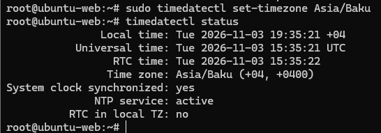

**NTP-002.** siem-host uses Asia/Baku and reports a synchronized system clock with NTP active.

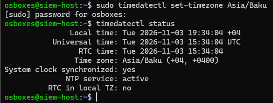

**NTP-003.** Windows selects Azerbaijan Standard Time and displays the Baku timezone and local date.

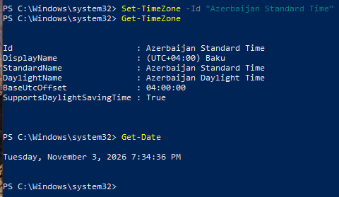

</details>

## 0.2 siem-host — Chrony server and upstream synchronization

**Run on:** siem-host. **Configuration:** `/etc/chrony/chrony.conf`. **Network:** existing NAT reaches upstream NTP; the host-only subnet is permitted to query UDP/123.

Commands reported in the handoff; service/source/listening results are supported by the captures below:

```bash
sudo apt install -y chrony
sudo grep -qFx 'allow 192.168.38.0/24' /etc/chrony/chrony.conf || \
  echo 'allow 192.168.38.0/24' | sudo tee -a /etc/chrony/chrony.conf
sudo systemctl enable --now chrony
sudo systemctl restart chrony
chronyc tracking
chronyc sources -n
chronyc activity
sudo ss -lunp | grep ':123'
grep -nE '^[[:space:]]*(server|pool|allow|local)[[:space:]]' /etc/chrony/chrony.conf
```

The handoff gives these upstream directives. The screenshot of the file shows the `allow` line, while the source list confirms upstream selection. Merge into the existing file; retain other valid Chrony settings.

```conf
pool ntp.ubuntu.com        iburst maxsources 4
pool 0.ubuntu.pool.ntp.org iburst maxsources 1
pool 1.ubuntu.pool.ntp.org iburst maxsources 1
pool 2.ubuntu.pool.ntp.org iburst maxsources 2
allow 192.168.38.0/24
```

<details>
<summary><code>apt install -y chrony</code></summary>

Installs the service. This command is supplied by the handoff; the DOCX shows the resulting service state, not the package-install transcript.

</details>

<details>
<summary><code>grep -qFx ... || tee -a</code></summary>

Adds the exact subnet ACL only if it is absent. `allow` permits clients from 192.168.38.0/24; it does not open the host firewall or choose upstream servers.

</details>

<details>
<summary><code>pool</code>, <code>iburst</code>, <code>maxsources</code></summary>

Keeps upstream clock references available through the server NAT adapter. `iburst` accelerates initial measurements; `maxsources` limits sources obtained from each pool.

</details>

<details>
<summary><code>systemctl enable --now</code> / <code>restart</code></summary>

Starts Chrony, enables boot startup and reloads the edited configuration. Boot enablement is not a post-reboot test.

</details>

<details>
<summary><code>chronyc tracking</code></summary>

Checks the selected reference, stratum, offset, frequency correction and leap state. The post-restart capture is stratum 0 / Not synchronised; another capture shows stratum 3 / Normal.

</details>

<details>
<summary><code>chronyc sources -n</code> / <code>activity</code></summary>

Checks source selection and online status. `^*` identifies the selected server; `-n` avoids name resolution. The handoff reports six online sources and a later Normal state; the screenshot uses `sources -v` and selects 91.234.235.13.

</details>

<details>
<summary><code>ss -lunp</code> / configuration grep</summary>

Confirms a UDP/123 listener and displays active source/ACL directives. The listener capture shows 0.0.0.0:123. If a firewall is enabled, separately permit UDP/123 from the lab subnet only; no firewall change is captured.

</details>

**Troubleshooting:** an initial read immediately after restart returned Reference ID `00000000`, stratum `0`, and `Not synchronised` even though UDP/123 was listening. The handoff reports recovery after upstream polling, with no extra manual clock fix; the DOCX also contains a synchronized server capture. No settling-time measurement or post-reboot result is supplied.

<details>
<summary><strong>Chrony server evidence · synchronized state, sources, ACL and restart transient</strong></summary>

**NTP-004.** siem-host Chrony is active, stratum 3, Leap status Normal; frequency correction is 12730.671 ppm slow.

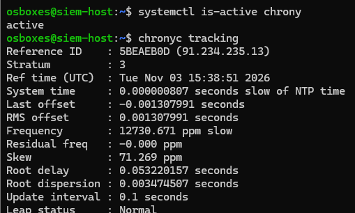

**NTP-005.** The server source list selects 91.234.235.13 with ^*; it also lists Ubuntu pools and other NTP sources.

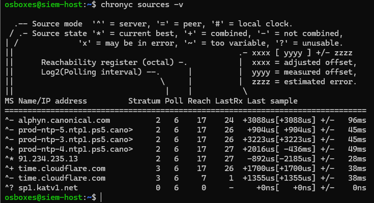

**NTP-006.** The server chrony.conf includes allow 192.168.38.0/24. Only the relevant tail of the file is shown.

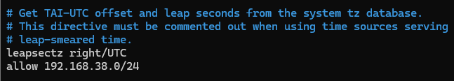

**NTP-007.** After a Chrony restart, ss shows UDP/123 listening; tracking reports stratum 0 and Not synchronised. This is not the final successful tracking capture.

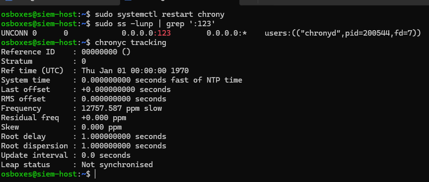

</details>

## 0.3 ubuntu-web — Chrony client

**Run on:** ubuntu-web. **Configuration:** `/etc/chrony/chrony.conf`.

The handoff reports installation and an initial external selection (`time.cloudflare.com`):

```bash
sudo apt install -y chrony
systemctl is-active chrony
chronyc tracking
chronyc sources -v
```

The recorded internal-peer addition is:

```bash
sudo cp /etc/chrony/chrony.conf /etc/chrony/chrony.conf.bak
echo 'server 192.168.38.132 iburst prefer' | sudo tee -a /etc/chrony/chrony.conf
sudo systemctl restart chrony
chronyc sources -n
chronyc tracking
```

```conf
server 192.168.38.132 iburst prefer
```

<details>
<summary><code>cp ...chrony.conf.bak</code></summary>

Preserves the current configuration before editing. Avoid overwriting an earlier rollback copy on a rerun.

</details>

<details>
<summary><code>server 192.168.38.132 iburst prefer</code></summary>

Adds the internal server and favors it among usable sources. Add the line once; compare existing entries before repeating the original append command.

</details>

<details>
<summary><code>restart</code>, <code>sources -n</code>, <code>tracking</code></summary>

Applies the change and checks actual source selection. The source screenshot selects `^* 192.168.38.132`. The handoff additionally reports reference C0A82684, stratum 4, Normal and an offset of about 0.000042497 seconds; that tracking output is not visible in the client screenshot.

</details>
<details>
<summary><strong>Chrony client evidence · peer line and selected internal source</strong></summary>

**NTP-008.** ubuntu-web chrony.conf contains server 192.168.38.132 iburst prefer.

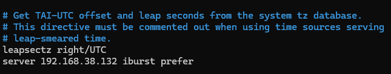

**NTP-009.** ubuntu-web selects ^* 192.168.38.132; additional external sources remain listed. Internal-only source configuration is not established.

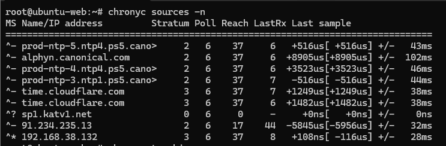

</details>

**Pending isolation step:** external sources still appear in the captured client source list. The following cleanup was advised in the original conversation; its application is **not confirmed**. After checking the existing file and internal peer, it comments out other active pool/server lines:

```bash
sudo cp /etc/chrony/chrony.conf /etc/chrony/chrony.conf.bak.external
sudo sed -i -E '/^[[:space:]]*(pool|server)[[:space:]]/ { /192\.168\.38\.132/! s/^/# /; }' /etc/chrony/chrony.conf
sudo systemctl restart chrony
chronyc sources -n
chronyc tracking
```

Do not mark internal-only NTP complete until the effective source list is retained after this change and after endpoint NAT removal.

## 0.4 win-client — Windows Time Service

**Run on:** win-client, elevated PowerShell. **Configuration:** Windows Time Service manual peer list and service startup type.

```powershell
w32tm /config /manualpeerlist:"192.168.38.132,0x8" /syncfromflags:manual /update
Set-Service W32Time -StartupType Automatic
Restart-Service W32Time
w32tm /resync /rediscover
w32tm /query /source
w32tm /query /status
```

<details>
<summary><code>w32tm /config</code></summary>

Sets the internal manual peer; `0x8` requests client mode. `/syncfromflags:manual` selects that peer list; `/update` applies the settings.

</details>

<details>
<summary><code>Set-Service</code> / <code>Restart-Service</code></summary>

Sets W32Time to Automatic and restarts it. The configuration command and successful resync are captured.

</details>

<details>
<summary><code>w32tm /resync /rediscover</code></summary>

Requests a new synchronization after rediscovering the configured source. Expect a completed synchronization, not merely an accepted config command.

</details>

<details>
<summary><code>w32tm /query /source</code> / <code>/status</code></summary>

Verifies the effective peer, stratum, leap indicator and last synchronization. The capture reports source `192.168.38.132,0x8`, stratum 4, no warning and last success 3 November 2026 at 19:48:22 Baku time.

</details>
<details>
<summary><strong>Windows time evidence · configuration and effective source</strong></summary>

**NTP-010.** w32tm applies peer 192.168.38.132,0x8; W32Time becomes Automatic, restarts and reports a successful resync.

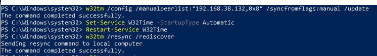

**NTP-011.** Windows reports source 192.168.38.132,0x8, stratum 4, no leap warning and a last successful sync time. Root dispersion is about 8.12 seconds.

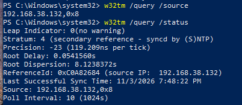

</details>

## 0.5 Verification limits and remaining checks

| Check | Evidence / status |
| :--- | :--- |
| Baku timezone on all machines | Captured on Linux and Windows |
| Server upstream synchronization | Selected upstream and stratum 3 / Normal captured; startup transient also retained |
| Server serves UDP/123 to the allowed subnet | Listener and `allow 192.168.38.0/24` captured; firewall state not shown |
| Linux internal peer | Selected ^* 192.168.38.132 captured; external peers still listed |
| Windows internal peer | Source, stratum 4 and last successful sync captured |
| Long-term precision | Open: server captures show roughly 12,731–12,758 ppm frequency correction; handoff reports the issue on both Linux VMs |
| Reboot persistence / final isolation | Open: retain post-reboot sources, service state and final endpoint routes |

A synchronized flag or a small sample offset is not a precision guarantee. Investigate VMware host/guest time synchronization and sustained drift; Windows also reports approximately 8.12 seconds of root dispersion. No virtual-clock fix is claimed here.

[Continue with Day 01](../README.md#step-01) · [Day 02 tests](../../day-02/README.md) · [NTP source images and hashes](../evidence/ntp/README.md)
