<p align="center">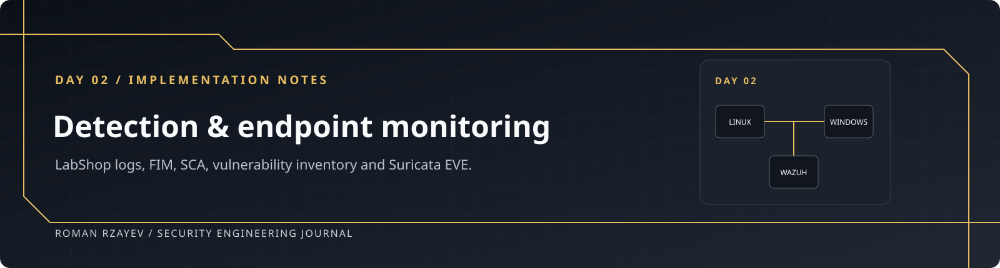</p>

<p align="center"><strong>Roman Rzayev</strong> · Wazuh 4.14.7 · Suricata 6.0.4 · Windows + Ubuntu</p>

# Day 02 · Detection and endpoint monitoring

This day adds application detections, file/Registry monitoring, SCA hardening and a Suricata HTTP rule to the existing deployment. Commands and key results are shown inline. Expand an arrow for command notes or supporting screenshots; click an image to open its original resolution.

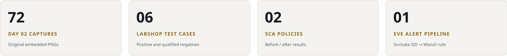

**Before generating fresh evidence:** complete [NTP and timezone synchronization at the beginning of Day 01](../day-01/README.md#ntp-time-synchronization).

| Application | Endpoint / assessment | Network detection |
| :--- | :--- | :--- |
| [01 · Source collection](#step-01) | [04 · Linux realtime FIM](#step-04) | [11 · Installation / DNS](#step-11) |
| [02 · Full decoder and rules](#step-02) | [05 · Windows files](#step-05) · [06 · Registry](#step-06) | [12 · ens33 / HOME_NET](#step-12) |
| [03 · Six tests](#step-03) | [07 · Scheduled FIM](#step-07) · [08 · SCA](#step-08) | [13 · HTTP signature](#step-13) |
| [Test verdict matrix](docs/test-matrix.md) | [09 · SCA remediation](#step-09) · [10 · Vulnerabilities](#step-10) | [14 · Packet/log validation](#step-14) |
| [Source notes](docs/source-notes.md) | [Acceptance gaps](docs/acceptance.md) | [15 · EVE collection](#step-15) · [16 · Wazuh 86601](#step-16) |

## Environment

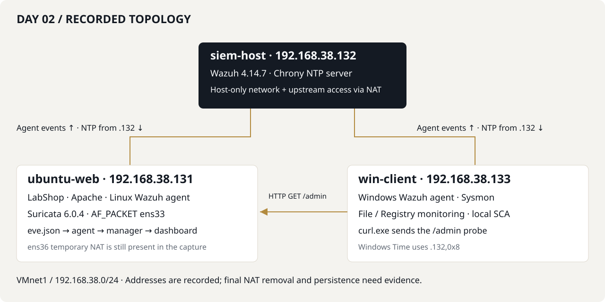

| Host | Address | Main work |
| :--- | :--- | :--- |
| siem-host | 192.168.38.132 | Wazuh manager/container rules; Chrony server |
| ubuntu-web | 192.168.38.131 | LabShop, Apache, agent, FIM, SCA and Suricata ens33 |
| win-client | 192.168.38.133 | Windows agent, files/Registry/SCA and the HTTP probe |

## Results at a glance

| Supported by captures | Qualification / open check |
| :--- | :--- |
| LabShop 100100/5 and 100101/10 positives | Split-source negative contains a correlation alert; success/malformed verdicts need stronger proof |
| Linux/Windows file events and Registry changes | Scheduled interval restoration, exact Windows interval and formal latency comparison are not proved |
| Ubuntu SCA 92→94 passed; Windows 117→118 passed | Remaining policy failures and CVE remediation are separate work |
| Suricata SID 1000001 reaches Wazuh 86601/3 from eve.json | IDS action allowed; no blocking, reboot or final-isolation claim |

**Sources:** the execution handoff and the 25-page uploaded DOCX. All 83 media objects are preserved: 11 NTP images in Day 01 and 72 here. [Source notes](docs/source-notes.md) distinguish captured results, handoff reports and replay instructions. The VMs were not operated by this documentation work.

## Event paths

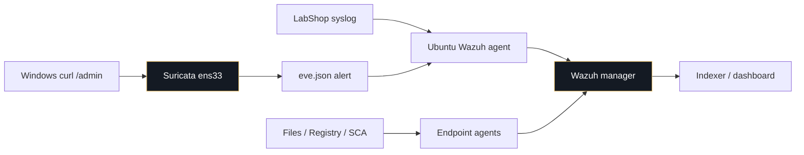

For LabShop, custom manager rules use 100100/100101. For Suricata, custom network signature 1000001 is classified by built-in Wazuh 86601. These identifiers belong to different rule systems.


<a id="step-01"></a>

## 1. LabShop application logs

**Run on:** ubuntu-web

**Configuration / view:** `/var/log/labshop/app.log`; agent `/var/ossec/etc/ossec.conf`

The recorded application messages have a syslog header and a LabShop payload. Check that format before choosing the decoder:

```bash
sudo tail -n 5 /var/log/labshop/app.log
```

The raw records contain `labshop[PID]: LOGIN_FAILED user=admin src=192.168.38.133`. The endpoint agent collects the existing file with:

```xml
<!-- Merge into the Linux agent's existing ossec_config on ubuntu-web. -->
<localfile>
  <log_format>syslog</log_format>
  <location>/var/log/labshop/app.log</location>
</localfile>
```

**Replay / verification commands** — the XML and raw log are captured; these editing/reload commands are documented steps rather than a captured installation transcript:

```bash
sudoedit /var/ossec/etc/ossec.conf
sudo systemctl restart wazuh-agent
sudo systemctl is-active wazuh-agent
sudo grep -n -A 4 'labshop/app.log' /var/ossec/etc/ossec.conf
```

<details>
<summary><code>tail -n 5</code></summary>

Reads recent raw application messages. Expect a syslog-style prefix, `labshop` program name and action/user/src payload; W2-012 records that format.

</details>

<details>
<summary><code>localfile</code>, <code>log_format</code>, <code>location</code></summary>

Adds this source to logcollector on the endpoint. `syslog` enables header pre-decoding; the path is on ubuntu-web, not inside the manager container.

</details>

<details>
<summary><code>sudoedit</code>, <code>systemctl restart</code>, <code>is-active</code></summary>

Merge the entry once inside the existing ossec_config, reload the agent and check its current state. The later manager/dashboard results establish delivery, but this DOCX does not show this particular service check.

</details>

<details>
<summary><code>grep -n -A 4</code></summary>

Shows the effective collection entry with line numbers. Expect one matching localfile entry, not duplicated configuration.

</details>
<details>
<summary><strong>Application log and agent collection entry</strong></summary>

**W2-012.** tail shows syslog-style LabShop LOGIN_FAILED records with user and src fields in /var/log/labshop/app.log.

<table width="900"><tr><td width="900" align="center"><a href="evidence/screenshots/012-labshop-log-format.png">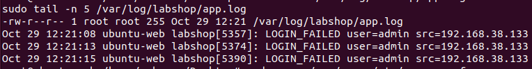</a></td></tr></table>

[Open original PNG](evidence/screenshots/012-labshop-log-format.png)

**W2-013.** The endpoint localfile fragment collects /var/log/labshop/app.log as syslog.

<table width="900"><tr><td width="900" align="center"><a href="evidence/screenshots/013-labshop-agent-localfile.png">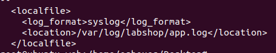</a></td></tr></table>

[Open original PNG](evidence/screenshots/013-labshop-agent-localfile.png)

</details>

The generator is already present at `/home/osboxes/Desktop/labshop_gen.sh` in the captured shell prompts. Its implementation is not included in the DOCX or handoff; this repository documents the observed invocations without inventing a replacement application.


<a id="step-02"></a>

## 2. LabShop decoder and custom rules

**Run on:** siem-host; Wazuh manager container

**Configuration / view:** `/var/ossec/etc/decoders/labshop_decoders.xml`; `/var/ossec/etc/rules/labshop_rules.xml`

The final decoder extracts the static fields `action`, `dstuser` and `srcip`. The definition below follows W2-014, including `\w+` for the action token:

```xml
<!-- Final definitions transcribed from WEEK2.docx image14.
     Wazuh decoder files allow multiple top-level decoder elements. -->
<decoder name="labshop">
  <program_name>^labshop$</program_name>
</decoder>

<decoder name="labshop-login">
  <parent>labshop</parent>
  <regex>^(\w+) user=(\S+) src=(\S+)</regex>
  <order>action,dstuser,srcip</order>
</decoder>
```

The final rules follow W2-016:

```xml
<!-- Transcribed from WEEK2.docx image16. IDs overlap the historical Day 01
     Sysmon example. Inspect active manager rules before loading this file. -->
<group name="labshop,">
  <rule id="100100" level="5">
    <decoded_as>labshop</decoded_as>
    <action>LOGIN_FAILED</action>
    <user negate="yes">^monitor$</user>
    <description>LabShop: failed login to the shop application.</description>
    <mitre><id>T1110</id></mitre>
  </rule>

  <rule id="100101" level="10" frequency="5" timeframe="60">
    <if_matched_sid>100100</if_matched_sid>
    <same_srcip />
    <description>LabShop: brute force, 5 failed logins from the same IP within 60 seconds.</description>
    <mitre><id>T1110</id></mitre>
  </rule>
</group>
```
<details>
<summary><code>program_name</code> / <code>parent</code></summary>

Restricts parsing to the pre-decoded `labshop` program, then applies the child decoder to its payload.

</details>

<details>
<summary><code>regex</code> / <code>order</code></summary>

Captures action, username and source IP in that order. The existing draft used a different first token expression; the captured definition uses `^(\w+)`.

</details>

<details>
<summary><code>decoded_as</code>, <code>action</code>, <code>user negate</code></summary>

Matches a LabShop failed login and excludes exactly `monitor`. `action` is a static Wazuh field; the handoff reports fixing an earlier `<field name="action">` attempt by using `<action>LOGIN_FAILED</action>`. Only the final definition is captured.

</details>

<details>
<summary><code>if_matched_sid</code>, <code>frequency</code>, <code>timeframe</code>, <code>same_srcip</code></summary>

Correlates matches of 100100 within the configured 60-second window for one source IP. The XML sets frequency=5 and the description says five failures; the bulk-generator tests do not measure an exact firing threshold or reset behavior.

</details>

<details>
<summary><code>mitre/T1110</code></summary>

Retains the technique tag present in the captured rules. The prior draft added authentication groups not visible in the source; those additions are not represented as deployed here.

</details>

### Rule-ID conflict and the recorded correction

The historical [Day 01 Sysmon file](../day-01/config/windows-discovery-rules.xml) also uses 100100–100103. The handoff reports moving those Sysmon rules in `local_rules.xml` to **100200–100203** before using the LabShop block. A post-migration Sysmon screenshot is not supplied. Preserve the historical Day 01 evidence, but **do not load both ID sets together**.

| Historical Sysmon ID | Handoff-reported replacement | LabShop ID |
| :--- | :--- | :--- |
| 100100 → whoami | 100200 | 100100 / level 5 |
| 100101 → ipconfig | 100201 | 100101 / level 10 |
| 100102 → hostname | 100202 | — |
| 100103 → encoded PowerShell | 100203 | — |

Inspect the live rules first; compare existing definitions and migrate/remove conflicts before copying anything. The following is a **documented replay procedure**, not evidence of new execution by this documentation task:

```bash
sudo docker exec single-node-wazuh.manager-1 sh -c 'grep -R -nE "100100|100101|100102|100103|100200|100201|100202|100203" /var/ossec/etc/rules || true'
```

After resolving IDs and preserving existing local files, set the actual path to this portfolio checkout on siem-host:

```bash
SOC_PROJECT_DIR="$HOME/Automated-SOC-Workflow"
test -f "$SOC_PROJECT_DIR/days/day-02/config/labshop_decoders.xml"
sudo docker cp "$SOC_PROJECT_DIR/days/day-02/config/labshop_decoders.xml" single-node-wazuh.manager-1:/var/ossec/etc/decoders/labshop_decoders.xml
sudo docker cp "$SOC_PROJECT_DIR/days/day-02/config/labshop_rules.xml" single-node-wazuh.manager-1:/var/ossec/etc/rules/labshop_rules.xml
sudo docker exec single-node-wazuh.manager-1 chown wazuh:wazuh /var/ossec/etc/decoders/labshop_decoders.xml /var/ossec/etc/rules/labshop_rules.xml
sudo docker exec single-node-wazuh.manager-1 chmod 640 /var/ossec/etc/decoders/labshop_decoders.xml /var/ossec/etc/rules/labshop_rules.xml
sudo docker exec single-node-wazuh.manager-1 /var/ossec/bin/wazuh-analysisd -t
```

The actual captured decoder check is:

```bash
sudo docker exec -it single-node-wazuh.manager-1 /var/ossec/bin/wazuh-logtest
```

Paste the raw line, not a JSON alert wrapper. The recorded input was:

```text
Oct 29 20:15:01 ubuntu-web labshop[2521]: LOGIN_FAILED user=admin src=192.168.38.133
```

W2-015 shows decoder `labshop`, `action=LOGIN_FAILED`, `dstuser=admin`, `srcip=192.168.38.133`. Exit the interactive tool with Ctrl+C. After a successful syntax check, the handoff's runtime configuration can be reloaded with the following replay command:

```bash
sudo docker restart single-node-wazuh.manager-1
```

<details>
<summary>Duplicate-ID search</summary>

Checks the live manager, including local_rules.xml. The historical source files in this portfolio are not an instruction to install duplicate IDs.

</details>

<details>
<summary><code>docker cp</code>, <code>chown</code>, <code>chmod</code></summary>

Copies reviewed definitions into manager configuration storage and gives the service read access. Preserve any existing customized file before replacing it; the exact copy commands are replay instructions, not screenshots.

</details>

<details>
<summary><code>wazuh-analysisd -t</code></summary>

Tests configuration syntax and rule loading. Stop on an error; no original error transcript is fabricated for the static-field correction.

</details>

<details>
<summary><code>wazuh-logtest</code></summary>

Tests actual pre-decoding, extracted fields and final rule selection for the input. W2-015 shows Phase 2; W2-018 independently shows the positive dashboard rule.

</details>

<details>
<summary><code>docker restart</code></summary>

Reloads the manager after validation. Recheck the service and agents; this is not a reboot-persistence result.

</details>
**W2-015.** Wazuh-logtest 4.14.7 decodes LOGIN_FAILED, admin and 192.168.38.133. The capture establishes Phase 2 fields.

<table width="900"><tr><td width="900" align="center"><a href="evidence/screenshots/015-labshop-decoder-logtest.png">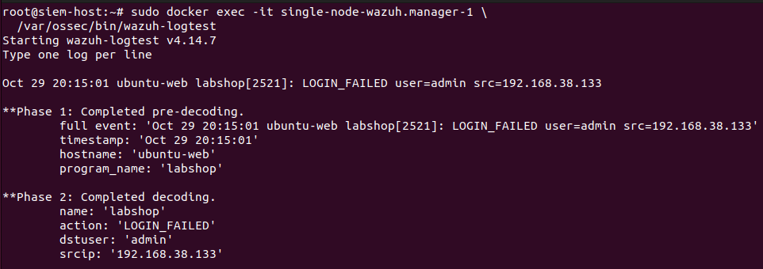</a></td></tr></table>

[Open original PNG](evidence/screenshots/015-labshop-decoder-logtest.png)

**W2-016.** Rules 100100/5 and 100101/10 use action, monitor exclusion, frequency=5, timeframe=60, same_srcip and MITRE T1110.

<table width="900"><tr><td width="900" align="center"><a href="evidence/screenshots/016-labshop-rule-definitions.png">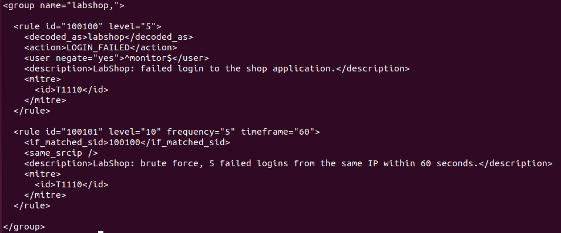</a></td></tr></table>

[Open original PNG](evidence/screenshots/016-labshop-rule-definitions.png)

<details>
<summary><strong>Supporting screenshots · Final decoder, Phase 2 fields and rule definitions</strong></summary>

**W2-014.** The captured parent/child decoders match program labshop and extract action,dstuser,srcip using a leading \w+ action capture.

<table width="900"><tr><td width="900" align="center"><a href="evidence/screenshots/014-labshop-decoder-definitions.png">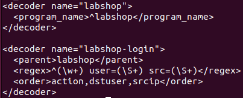</a></td></tr></table>

[Open original PNG](evidence/screenshots/014-labshop-decoder-definitions.png)

</details>


<a id="step-03"></a>

## 3. Six LabShop detection tests

**Run on:** ubuntu-web for generation; manager for logtest; dashboard for results

**Configuration / view:** Existing `/home/osboxes/Desktop/labshop_gen.sh`; `/var/log/labshop/app.log`; Wazuh alerts

Run the recorded generator from its existing directory. Its four positional arguments are outcome (`fail` / `ok`), account, source-IP text and requested message count. The supplied IP is a log field: these commands generate application records, not network attacks against the 10.10.10.x addresses.

```bash
cd /home/osboxes/Desktop
```

Use separate correlation windows when repeating cases. The original captures are not a controlled reset of the manager's correlation state.

### Test 1 — single failed login

```bash
./labshop_gen.sh fail admin 192.168.38.133 1
```

The capture shows this invocation repeated three times. W2-018 records three `ubuntu-web` rows with **100100 / level 5** and the failed-login description.

**W2-018.** Three ubuntu-web dashboard rows show failed-login rule 100100 at level 5.

<table width="900"><tr><td width="900" align="center"><a href="evidence/screenshots/018-test1-single-failure-dashboard.png">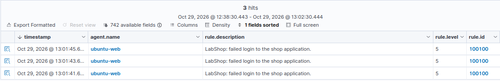</a></td></tr></table>

[Open original PNG](evidence/screenshots/018-test1-single-failure-dashboard.png)

<details>
<summary><strong>Supporting screenshots · Test 1 · command and positive dashboard result</strong></summary>

**W2-017.** The generator is invoked three times with fail admin 192.168.38.133 1.

<table width="900"><tr><td width="900" align="center"><a href="evidence/screenshots/017-test1-single-failure-command.png">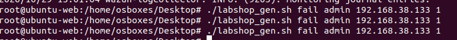</a></td></tr></table>

[Open original PNG](evidence/screenshots/017-test1-single-failure-command.png)

</details>

### Test 2 — repeated failures from one source

```bash
./labshop_gen.sh fail admin 192.168.38.133 6
```

This command is also repeated three times in the source. The dashboard shows **100101 / level 10**. The code configures frequency=5/timeframe=60; the evidence does not establish that one isolated group of exactly five events fires at a precisely measured time.

**W2-020.** The dashboard shows three 100101 level-10 correlation alerts; the description says five failures in 60 seconds.

<table width="900"><tr><td width="900" align="center"><a href="evidence/screenshots/020-test2-brute-force-dashboard.png">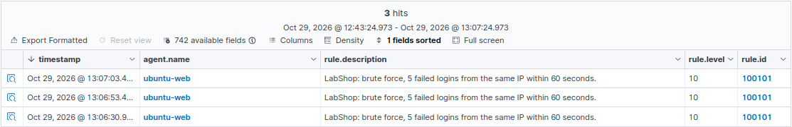</a></td></tr></table>

[Open original PNG](evidence/screenshots/020-test2-brute-force-dashboard.png)

<details>
<summary><strong>Supporting screenshots · Test 2 · bulk generation and correlation alert</strong></summary>

**W2-019.** The generator is invoked three times with fail admin 192.168.38.133 6. Exact per-event timing is not shown.

<table width="900"><tr><td width="900" align="center"><a href="evidence/screenshots/019-test2-brute-force-command.png">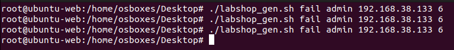</a></td></tr></table>

[Open original PNG](evidence/screenshots/019-test2-brute-force-command.png)

</details>

### Test 3 — exclude the monitoring account

```bash
./labshop_gen.sh fail monitor 10.10.10.1 1
```

Three invocations appear in W2-021. A manual logtest of the same account extracts the expected fields and ends at **generic rule 1002 / level 2**, not custom 100100/100101. The screenshot title “No rule triggered” is too broad: the custom detector is excluded, but a generic rule does match.

**W2-022.** monitor decodes correctly and does not match the custom failure rule in the displayed test; generic rule 1002, level 2, does match. This is not a zero-rule result.

<table width="900"><tr><td width="900" align="center"><a href="evidence/screenshots/022-test3-monitor-logtest-fallback.png">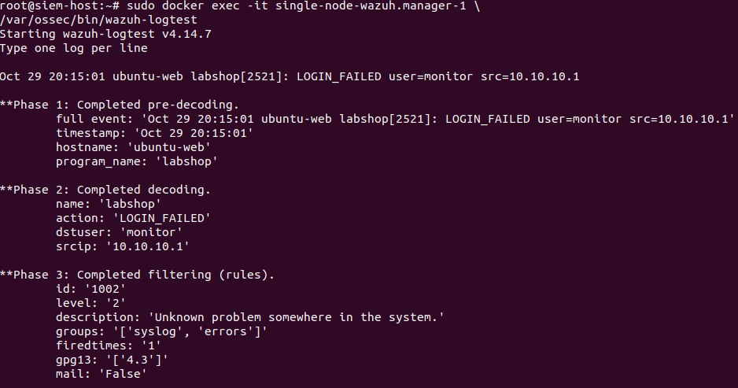</a></td></tr></table>

[Open original PNG](evidence/screenshots/022-test3-monitor-logtest-fallback.png)

<details>
<summary><strong>Supporting screenshots · Test 3 · exclusion and generic fallback</strong></summary>

**W2-021.** Three generator invocations use fail monitor 10.10.10.1 1.

<table width="900"><tr><td width="900" align="center"><a href="evidence/screenshots/021-test3-monitor-account-command.png">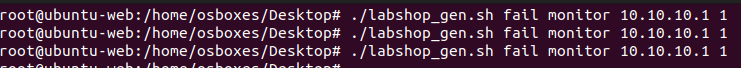</a></td></tr></table>

[Open original PNG](evidence/screenshots/021-test3-monitor-account-command.png)

</details>

### Test 4 — failures split across two source addresses

```bash
./labshop_gen.sh fail admin 10.10.10.50 3
./labshop_gen.sh fail admin 10.10.10.60 3
```

**Expected:** independent sources should not be combined by `same_srcip`. **Recorded:** W2-024 nevertheless includes a 100101/10 row plus two 100100/5 rows. The crop omits source-IP fields and previous event context. It proves neither a clean negative result nor that the engine ignored `same_srcip`. Repeat this case in an isolated window and retain expanded source fields before accepting it as a passed negative test.

**W2-024.** The associated dashboard crop includes 100101/10 and two 100100/5 rows. Source-IP fields and full test context are absent; a clean negative result is not demonstrated.

<table width="900"><tr><td width="900" align="center"><a href="evidence/screenshots/024-test4-split-source-dashboard.png">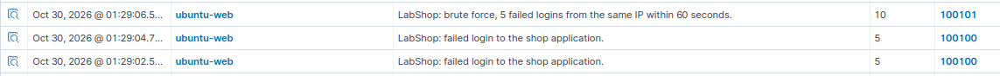</a></td></tr></table>

[Open original PNG](evidence/screenshots/024-test4-split-source-dashboard.png)

<details>
<summary><strong>Supporting screenshots · Test 4 · retained conflicting result</strong></summary>

**W2-023.** Two generator invocations request three failures from 10.10.10.50 and three from 10.10.10.60.

<table width="900"><tr><td width="900" align="center"><a href="evidence/screenshots/023-test4-split-source-command.png">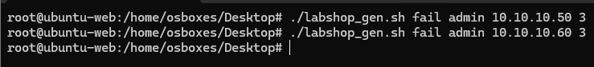</a></td></tr></table>

[Open original PNG](evidence/screenshots/023-test4-split-source-command.png)

</details>

### Test 5 — successful login

```bash
./labshop_gen.sh ok alice 10.10.10.50 2
sudo tail -n 2 /var/log/labshop/app.log
```

Two generator invocations appear in W2-025; W2-026 shows the latest two `LOGIN_OK` lines. The configured failure rule should not match that action. The handoff reports suppression, but the screenshot itself proves log generation, not absence of a custom dashboard alert.

<details>
<summary><strong>Test 5 · successful-login source records</strong></summary>

**W2-025.** The generator is invoked twice with ok alice 10.10.10.50 2.

<table width="900"><tr><td width="900" align="center"><a href="evidence/screenshots/025-test5-successful-login-command.png">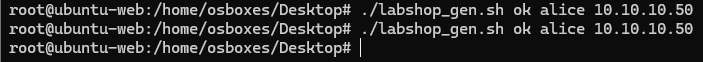</a></td></tr></table>

[Open original PNG](evidence/screenshots/025-test5-successful-login-command.png)

**W2-026.** The raw log contains LOGIN_OK records for alice. This does not independently verify the absence of a custom dashboard alert.

<table width="900"><tr><td width="900" align="center"><a href="evidence/screenshots/026-test5-successful-login-log.png">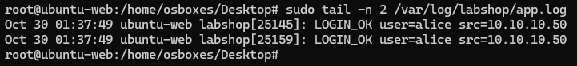</a></td></tr></table>

[Open original PNG](evidence/screenshots/026-test5-successful-login-log.png)

</details>

### Test 6 — malformed application payload

```bash
echo "$(date '+%b %e %H:%M:%S') $(hostname) labshop[9999]: INVALID_DATA test=hello" | sudo tee -a /var/log/labshop/app.log
sudo tail -n 3 /var/log/labshop/app.log
```

For the captured manager logtest, the literal input is:

```text
Oct 30 09:30:00 ubuntu-web labshop[9999]: INVALID_DATA test=hello
```

The message keeps a valid syslog prefix but omits the expected `user=... src=...` payload. W2-028 shows **Phase 1 pre-decoding only** (hostname/program_name). The handoff reports no custom match; the crop does not show a complete final verdict. Do not describe it as successful structured LabShop decoding.

<details>
<summary><strong>Test 6 · malformed source and limited logtest output</strong></summary>

**W2-027.** An INVALID_DATA test=hello message is appended with a syslog-style prefix; tail shows the resulting raw line.

<table width="900"><tr><td width="900" align="center"><a href="evidence/screenshots/027-test6-malformed-log-command.png">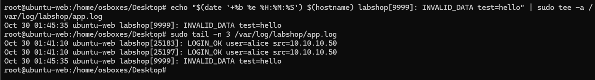</a></td></tr></table>

[Open original PNG](evidence/screenshots/027-test6-malformed-log-command.png)

**W2-028.** The malformed line reaches Phase 1 pre-decoding, with hostname and program_name. Structured field extraction and the final rule verdict are not shown.

<table width="900"><tr><td width="900" align="center"><a href="evidence/screenshots/028-test6-malformed-logtest.png">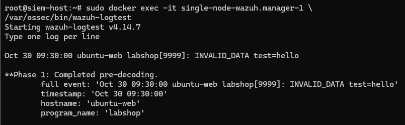</a></td></tr></table>

[Open original PNG](evidence/screenshots/028-test6-malformed-logtest.png)

</details>
<details>
<summary><code>labshop_gen.sh</code> arguments</summary>

Use the recorded arguments above. `1`, `6`, `3` and `2` are requested message counts; the source script body and exact inter-event delay are unavailable.

</details>

<details>
<summary><code>tail</code></summary>

Reads the generated source records. A successful source write is distinct from a matched manager alert.

</details>

<details>
<summary><code>date</code>, <code>hostname</code>, <code>tee -a</code></summary>

Constructs the recorded syslog-style malformed message and appends it to the monitored file. The content is deliberately malformed for the child decoder, not for the syslog predecoder.

</details>

<details>
<summary>Dashboard / logtest verdicts</summary>

Keep expected and actual results separate. A generic rule match or cropped test cannot be promoted to “no alert at all”.

</details>

The [test matrix](docs/test-matrix.md) keeps these six verdicts and their acceptance gaps in one place.


<a id="step-04"></a>

## 4. Linux realtime File Integrity Monitoring

**Run on:** ubuntu-web

**Configuration / view:** Agent `/var/ossec/etc/ossec.conf` → existing `syscheck` block

The web-directory entry is realtime; the system-directory entries remain scheduled. This is the captured syscheck portion, not a replacement for the whole agent file:

```xml
<!-- Captured portion of the EXISTING syscheck block (images29,46).
     Merge relevant settings; retain the existing ignore/nodiff/other options.
     Do not append a second conflicting syscheck block. -->
<syscheck>
  <disabled>no</disabled>
  <frequency>43200</frequency>
  <scan_on_start>yes</scan_on_start>
  <directories>/etc,/usr/bin,/usr/sbin</directories>
  <directories>/bin,/sbin,/boot</directories>
  <directories check_all="yes" realtime="yes" report_changes="yes">/var/www/html</directories>
</syscheck>
```

Merge the web entry once, retain existing ignores/nodiff settings, then reload the agent (replay step):

```bash
sudo systemctl restart wazuh-agent
```

The actual test sequence runs as root in the source. If using an administration account, prefix the file operations with sudo:

```bash
touch /var/www/html/fim-test
echo "Modified Content" > /var/www/html/fim-test
```

The captured delete command uses `rm -rf /var/www/html/fim-test`. For replay of this known regular test file, use the narrower operation below; it is an explicit safety adjustment, not a claim about the original command:

```bash
rm -- /var/www/html/fim-test
```

<details>
<summary><code>realtime="yes"</code> / <code>check_all="yes"</code></summary>

Enables realtime filesystem notifications and available integrity attributes for this directory. W2-032 explicitly shows syscheck.mode=realtime and the test path.

</details>

<details>
<summary><code>report_changes="yes"</code></summary>

Requests content-change reporting where supported. A rule 550 row alone is not proof that a full diff was retained.

</details>

<details>
<summary><code>touch</code> / shell redirection</summary>

Creates the test file, then overwrites its contents. The shell must have write permission before it performs `>` redirection.

</details>

<details>
<summary><code>rm --</code></summary>

Deletes the known regular test file without recursively removing a directory. The original rm -rf command remains visible in W2-035 for traceability.

</details>

<details>
<summary>Expected / recorded result</summary>

File-added **554/5**, integrity-changed **550/7** and file-deleted **553/7** appear. No precise latency average is derived from these captures.

</details>
**W2-029.** The Linux syscheck configuration adds realtime/check_all/report_changes monitoring for /var/www/html.

<table width="900"><tr><td width="900" align="center"><a href="evidence/screenshots/029-linux-realtime-fim-config.png">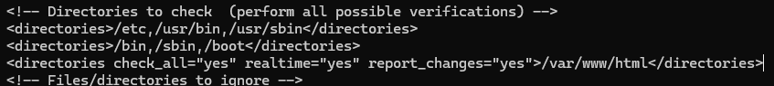</a></td></tr></table>

[Open original PNG](evidence/screenshots/029-linux-realtime-fim-config.png)

**W2-032.** The expanded record identifies syscheck.mode=realtime and path /var/www/html/fim-test, with timestamps and hash fields.

<table width="900"><tr><td width="900" align="center"><a href="evidence/screenshots/032-linux-fim-realtime-detail.png">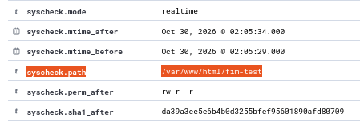</a></td></tr></table>

[Open original PNG](evidence/screenshots/032-linux-fim-realtime-detail.png)

<details>
<summary><strong>Supporting screenshots · Linux FIM · configuration, create event and realtime fields</strong></summary>

**W2-030.** touch creates /var/www/html/fim-test.

<table width="900"><tr><td width="900" align="center"><a href="evidence/screenshots/030-linux-fim-create-command.png">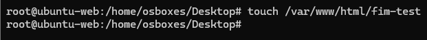</a></td></tr></table>

[Open original PNG](evidence/screenshots/030-linux-fim-create-command.png)

**W2-031.** ubuntu-web rows show file-added rule 554/5 and integrity-changed rule 550/7.

<table width="900"><tr><td width="900" align="center"><a href="evidence/screenshots/031-linux-fim-create-dashboard.png">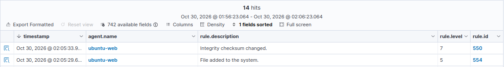</a></td></tr></table>

[Open original PNG](evidence/screenshots/031-linux-fim-create-dashboard.png)

</details>
<details>
<summary><strong>Linux FIM · modification and deletion</strong></summary>

**W2-033.** echo overwrites the monitored test file with Modified Content.

<table width="900"><tr><td width="900" align="center"><a href="evidence/screenshots/033-linux-fim-modify-command.png">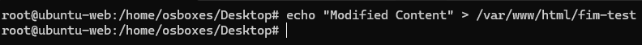</a></td></tr></table>

[Open original PNG](evidence/screenshots/033-linux-fim-modify-command.png)

**W2-034.** The dashboard lists integrity-changed rule 550 at level 7 for ubuntu-web.

<table width="900"><tr><td width="900" align="center"><a href="evidence/screenshots/034-linux-fim-modify-dashboard.png">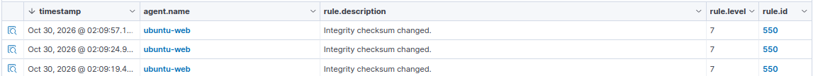</a></td></tr></table>

[Open original PNG](evidence/screenshots/034-linux-fim-modify-dashboard.png)

**W2-035.** The terminal deletes the single test path with rm -rf. The guide uses rm -- for a known regular file as an explicitly safer replay.

<table width="900"><tr><td width="900" align="center"><a href="evidence/screenshots/035-linux-fim-delete-command.png">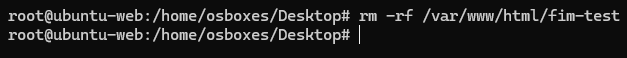</a></td></tr></table>

[Open original PNG](evidence/screenshots/035-linux-fim-delete-command.png)

**W2-036.** The dashboard includes File deleted rule 553 at level 7.

<table width="900"><tr><td width="900" align="center"><a href="evidence/screenshots/036-linux-fim-delete-dashboard.png">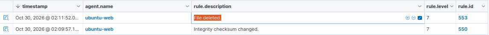</a></td></tr></table>

[Open original PNG](evidence/screenshots/036-linux-fim-delete-dashboard.png)

</details>


<a id="step-05"></a>

## 5. Windows file monitoring

**Run on:** win-client; elevated PowerShell

**Configuration / view:** `C:\Program Files (x86)\ossec-agent\ossec.conf` → `syscheck`

The file entry in W2-037 is:

```xml
<directories check_all="yes" realtime="yes" report_changes="yes">C:\LabShopData</directories>
```

The test directory already exists in the source. These checks/reload commands are replay preparation, not a captured directory-creation procedure:

```powershell
Test-Path 'C:\LabShopData'
Restart-Service WazuhSvc
```

Run the captured operations one at a time and check the corresponding dashboard event:

```powershell
Set-Content -Path 'C:\LabShopData\test.txt' -Value 'Original LabShop Data'
Add-Content -Path 'C:\LabShopData\test.txt' -Value 'Modified LabShop Data'
Remove-Item -Path 'C:\LabShopData\test.txt'
```

<details>
<summary><code>Test-Path</code> / <code>Restart-Service</code></summary>

Checks the existing lab directory and reloads the edited agent. Do not assume the source shows how this directory was first provisioned.

</details>

<details>
<summary><code>Set-Content</code></summary>

Writes the initial file contents. The dashboard records a file-added event (554/5), with an integrity-change row also visible.

</details>

<details>
<summary><code>Add-Content</code></summary>

Appends a second line; the source records integrity-changed 550/7. The crop does not expand the content diff.

</details>

<details>
<summary><code>Remove-Item</code></summary>

Deletes this test file; the dashboard shows file-deleted 553/7.

</details>

<details>
<summary>XML directory attributes</summary>

The directory path is on win-client. These realtime file options do not make Registry monitoring realtime.

</details>
**W2-037.** Select-String shows realtime file monitoring for C:\LabShopData and arch=both registry monitoring for HKLM\SOFTWARE\LabShop.

<table width="900"><tr><td width="900" align="center"><a href="evidence/screenshots/037-windows-fim-registry-config.png">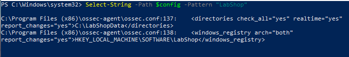</a></td></tr></table>

[Open original PNG](evidence/screenshots/037-windows-fim-registry-config.png)

<details>
<summary><strong>Supporting screenshots · Windows file FIM · configuration and creation</strong></summary>

**W2-038.** Set-Content writes Original LabShop Data to C:\LabShopData\test.txt.

<table width="900"><tr><td width="900" align="center"><a href="evidence/screenshots/038-windows-fim-create-command.png">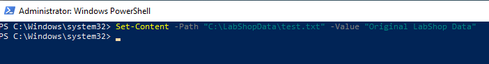</a></td></tr></table>

[Open original PNG](evidence/screenshots/038-windows-fim-create-command.png)

**W2-039.** win-client inventory rows show file-added 554/5 and integrity-changed 550/7.

<table width="900"><tr><td width="900" align="center"><a href="evidence/screenshots/039-windows-fim-create-dashboard.png">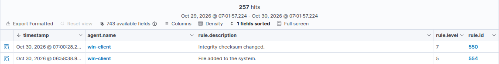</a></td></tr></table>

[Open original PNG](evidence/screenshots/039-windows-fim-create-dashboard.png)

</details>
**W2-043.** win-client dashboard includes file-deleted rule 553/7.

<table width="900"><tr><td width="900" align="center"><a href="evidence/screenshots/043-windows-fim-delete-dashboard.png">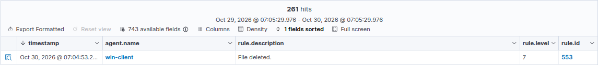</a></td></tr></table>

[Open original PNG](evidence/screenshots/043-windows-fim-delete-dashboard.png)

<details>
<summary><strong>Supporting screenshots · Windows file FIM · modification and deletion</strong></summary>

**W2-040.** Add-Content appends Modified LabShop Data to the monitored file.

<table width="900"><tr><td width="900" align="center"><a href="evidence/screenshots/040-windows-fim-modify-command.png">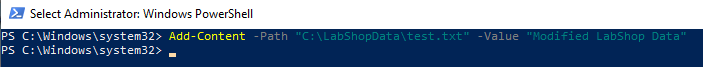</a></td></tr></table>

[Open original PNG](evidence/screenshots/040-windows-fim-modify-command.png)

**W2-041.** win-client rows include integrity-changed rule 550/7. Raw diff details are not expanded in this crop.

<table width="900"><tr><td width="900" align="center"><a href="evidence/screenshots/041-windows-fim-modify-dashboard.png">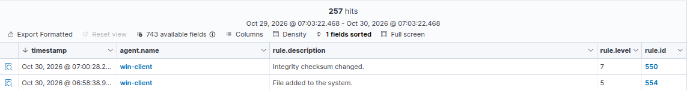</a></td></tr></table>

[Open original PNG](evidence/screenshots/041-windows-fim-modify-dashboard.png)

**W2-042.** Remove-Item deletes C:\LabShopData\test.txt.

<table width="900"><tr><td width="900" align="center"><a href="evidence/screenshots/042-windows-fim-delete-command.png">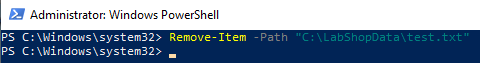</a></td></tr></table>

[Open original PNG](evidence/screenshots/042-windows-fim-delete-command.png)

</details>


<a id="step-06"></a>

## 6. Windows Registry monitoring

**Run on:** win-client; elevated PowerShell

**Configuration / view:** Agent syscheck; `HKLM\SOFTWARE\LabShop`

This is the captured Registry entry; merge it inside the existing syscheck block:

```xml
<windows_registry arch="both" report_changes="yes">HKEY_LOCAL_MACHINE\SOFTWARE\LabShop</windows_registry>
```

The key exists in the test environment. Inspect it before the captured change (the read command is a replay check):

```powershell
Get-ItemProperty -Path 'HKLM:\SOFTWARE\LabShop' -Name 'Environment'
Set-ItemProperty -Path 'HKLM:\SOFTWARE\LabShop' -Name 'Environment' -Value 'Development'
```

<details>
<summary><code>windows_registry</code> / <code>arch="both"</code></summary>

Monitors the specified key in the relevant 32-bit and 64-bit views. This is periodic Registry scanning, distinct from the realtime file entry.

</details>

<details>
<summary><code>report_changes</code></summary>

Requests Registry change details where supported. The screenshot identifies modified key/value records.

</details>

<details>
<summary><code>Get-ItemProperty</code> / <code>Set-ItemProperty</code></summary>

Reads the existing Environment value, then sets Development. W2-044 captures the write; no key-creation command is invented.

</details>

<details>
<summary>Scan interval and recorded result</summary>

The handoff reports shortening the Windows scan interval, but supplies no exact value and W2-037 does not show it. W2-045 records registry-value **750/5** and registry-key **594/5** modification rows; do not assume the Linux 60-second test interval applies here.

</details>
**W2-045.** Expanded columns identify HKLM\SOFTWARE\LabShop with modified entries: registry-value rule 750/5 and registry-key rule 594/5.

<table width="900"><tr><td width="900" align="center"><a href="evidence/screenshots/045-registry-modification-dashboard.png">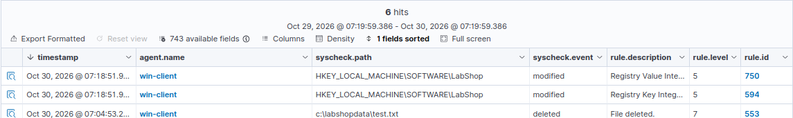</a></td></tr></table>

[Open original PNG](evidence/screenshots/045-registry-modification-dashboard.png)

<details>
<summary><strong>Supporting screenshots · Registry value change and dashboard classification</strong></summary>

**W2-044.** Set-ItemProperty changes the Environment value under HKLM:\SOFTWARE\LabShop to Development.

<table width="900"><tr><td width="900" align="center"><a href="evidence/screenshots/044-registry-modification-command.png">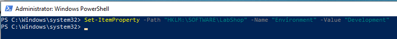</a></td></tr></table>

[Open original PNG](evidence/screenshots/044-registry-modification-command.png)

</details>


<a id="step-07"></a>

## 7. Scheduled Linux FIM and comparison

**Run on:** ubuntu-web

**Configuration / view:** Agent syscheck frequency; `/etc/labshop-fim-test.txt`

The source begins with a **43200-second (12-hour)** syscheck frequency and scan_on_start=yes. The subsequent agent log records a temporary **60-second** scan interval for the demonstration. Change the existing frequency value, not a duplicate block:

```xml
<frequency>60</frequency>
```

Captured configuration and scan-log inspection:

```bash
sudo sed -n '/<syscheck>/,/<\/syscheck>/p' /var/ossec/etc/ossec.conf
sudo grep 'File integrity monitoring scan frequency' /var/ossec/logs/ossec.log | tail -n 1
```

Captured test operations (a restart after editing is a required replay step):

```bash
sudo systemctl restart wazuh-agent
echo "Original FIM Content" | sudo tee /etc/labshop-fim-test.txt
date '+%Y-%m-%d %H:%M:%S'
echo "Scheduled FIM Modification Test" | sudo tee -a /etc/labshop-fim-test.txt
```

<details>
<summary><code>frequency</code> / <code>scan_on_start</code></summary>

Controls scheduled scans and startup scanning. The 60-second agent log proves the test interval became active; the original 43200 screenshot is not proof of a later restoration.

</details>

<details>
<summary><code>sed</code> / scan-frequency grep</summary>

Reads the relevant syscheck block and most recent scan interval. Inspect existing entries before changing configuration.

</details>

<details>
<summary><code>tee</code> / <code>tee -a</code></summary>

Creates the test file and later appends content. Dashboard file-added 554/5 and integrity-change 550/7 rows accompany the test.

</details>

<details>
<summary><code>date</code></summary>

Records command time (14:17:52 in W2-050). It does not by itself yield an alert-latency measurement: the dashboard crop includes other events and lacks the complete path/mode/context.

</details>
<details>
<summary><strong>Scheduled FIM · original configuration and temporary scan interval</strong></summary>

**W2-046.** The original syscheck block sets frequency 43200, scan_on_start=yes, scheduled system directories and realtime web-directory monitoring.

<table width="900"><tr><td width="900" align="center"><a href="evidence/screenshots/046-scheduled-fim-original-config.png">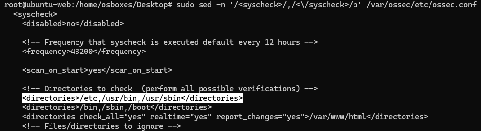</a></td></tr></table>

[Open original PNG](evidence/screenshots/046-scheduled-fim-original-config.png)

**W2-047.** The agent log states File integrity monitoring scan frequency: 60 seconds. This supports a temporary test setting, not a restored 12-hour interval.

<table width="900"><tr><td width="900" align="center"><a href="evidence/screenshots/047-scheduled-fim-test-frequency.png">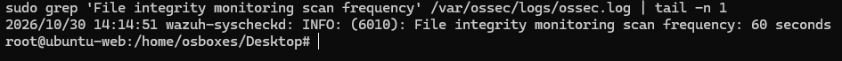</a></td></tr></table>

[Open original PNG](evidence/screenshots/047-scheduled-fim-test-frequency.png)

</details>
<details>
<summary><strong>Scheduled FIM · test writes and dashboard rows</strong></summary>

**W2-048.** tee creates /etc/labshop-fim-test.txt with Original FIM Content.

<table width="900"><tr><td width="900" align="center"><a href="evidence/screenshots/048-scheduled-fim-create-command.png">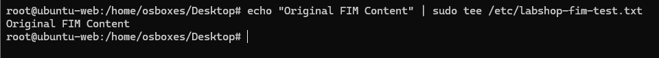</a></td></tr></table>

[Open original PNG](evidence/screenshots/048-scheduled-fim-create-command.png)

**W2-049.** The dashboard shows a file-added 554/5 row. The path/mode fields are not expanded here.

<table width="900"><tr><td width="900" align="center"><a href="evidence/screenshots/049-scheduled-fim-create-dashboard.png">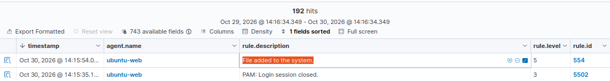</a></td></tr></table>

[Open original PNG](evidence/screenshots/049-scheduled-fim-create-dashboard.png)

**W2-050.** date displays 2026-10-30 14:17:52 before the test file is modified. This is the command timestamp, not an end-to-end latency measurement.

<table width="900"><tr><td width="900" align="center"><a href="evidence/screenshots/050-scheduled-fim-modify-command.png">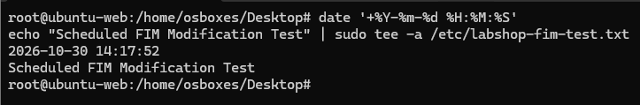</a></td></tr></table>

[Open original PNG](evidence/screenshots/050-scheduled-fim-modify-command.png)

**W2-051.** Integrity-changed rule 550/7 appears alongside a session event. The crop alone is insufficient for precise realtime-versus-scheduled timing.

<table width="900"><tr><td width="900" align="center"><a href="evidence/screenshots/051-scheduled-fim-modify-dashboard.png">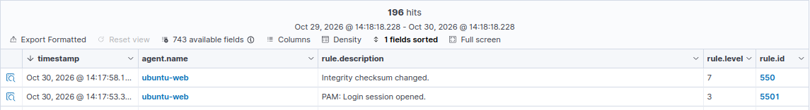</a></td></tr></table>

[Open original PNG](evidence/screenshots/051-scheduled-fim-modify-dashboard.png)

</details>

| Mode | Detection mechanism | Evidence limit |
| :--- | :--- | :--- |
| Realtime `/var/www/html` | Filesystem notifications | syscheck.mode=realtime is captured; no repeated timing benchmark |
| Scheduled `/etc` | Next periodic/startup scan | 60-second test interval and result rows captured; exact end-to-end latency not established |
| Windows Registry | Periodic Registry scan | Modification captured; temporary frequency value not supplied |

**Pending cleanup:** return the Linux test interval to `<frequency>43200</frequency>`, restart the agent and retain its effective scan-frequency log. Neither the handoff nor the updated DOCX proves this restoration or a post-reboot run.


<a id="step-08"></a>

## 8. Security Configuration Assessment baselines

**Run on:** Wazuh Dashboard; ubuntu-web and win-client agent views

**Configuration / view:** Configuration Assessment → agent → policy

SCA evaluates local configuration against a policy. These are configuration-compliance counts, not vulnerability counts or incident totals.

| Agent | Policy shown | Passed | Failed | N/A | Score |
| :--- | :--- | ---: | ---: | ---: | ---: |
| ubuntu-web | CIS Ubuntu Linux 22.04 LTS Benchmark v2.0.0 | 92 | 104 | 11 | 46% |
| win-client | CIS Microsoft Windows 10 Enterprise Benchmark v4.0.0 | 117 | 302 | 5 | 27% |

Open the relevant agent/policy rather than mixing the two hosts' totals. The following section changes two Ubuntu permissions checks and one Windows password-history check, then compares their results.

<details>
<summary><strong>SCA baselines · Ubuntu and Windows</strong></summary>

**W2-052.** Ubuntu CIS 22.04 v2.0.0 baseline: 92 passed, 104 failed, 11 not applicable; score 46%.

<table width="900"><tr><td width="900" align="center"><a href="evidence/screenshots/052-ubuntu-sca-baseline.png">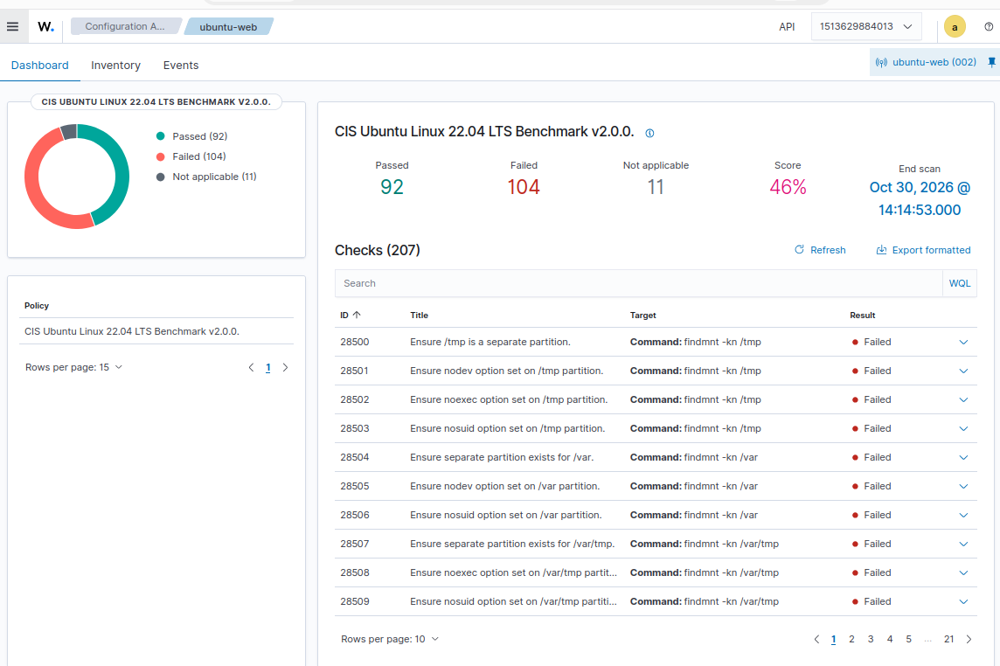</a></td></tr></table>

[Open original PNG](evidence/screenshots/052-ubuntu-sca-baseline.png)

**W2-053.** Windows 10 Enterprise CIS v4.0.0 baseline: 117 passed, 302 failed, 5 not applicable; score 27%.

<table width="900"><tr><td width="900" align="center"><a href="evidence/screenshots/053-windows-sca-baseline.png">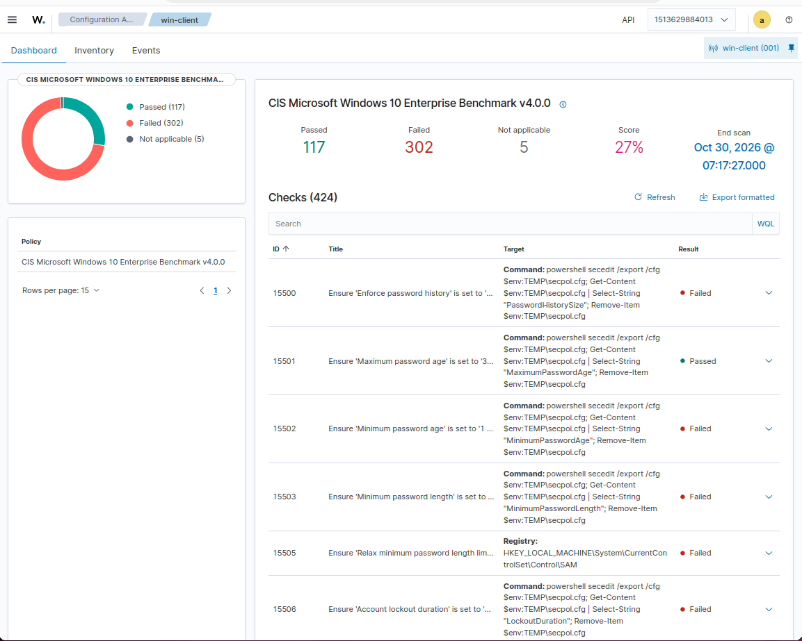</a></td></tr></table>

[Open original PNG](evidence/screenshots/053-windows-sca-baseline.png)

</details>
<details>
<summary>Passed / Failed / N/A</summary>

Counts refer to the selected policy and captured scan. N/A is not a pass; the percentage does not mean that percentage of attacks is blocked.

</details>

<details>
<summary>Before/after comparison</summary>

Keep host and policy version consistent. A passing local configuration check is not evidence that a separate CVE was patched.

</details>


<a id="step-09"></a>

## 9. SCA remediation and before/after results

**Run on:** ubuntu-web as root; win-client elevated PowerShell

**Configuration / view:** Ubuntu cron permissions; Windows local security policy

### Ubuntu — two permission checks

The captured policy excerpt identifies **28626** (`/etc/crontab`) and **28627** (`/etc/cron.hourly`). Inspect the recorded policy context with the command shown in W2-054:

```bash
sudo sed -n '1785,1860p' /var/ossec/ruleset/sca/cis_ubuntu22-04.yml | grep -E 'id:|title:|rules:|f:|d:|condition:'
```

Those line numbers belong to the captured policy version; on a different version, locate the check IDs rather than assuming the same offsets.

The original file was named `sca_fix.sh`; the same body is retained as [scripts/ubuntu-sca-remediation.sh](scripts/ubuntu-sca-remediation.sh):

```bash
#!/bin/bash
# Transcribed from WEEK2.docx image55; run only after reviewing this host's policy.
# The original mode backups below are overwritten on a second run.
set -euo pipefail

echo "===== BEFORE REMEDIATION ====="
stat -c '%a %U:%G %n' /etc/crontab /etc/cron.hourly

# Original permissions for rollback (modes only, not a full file/owner backup).
stat -c '%a' /etc/crontab > /root/crontab.perm.bak
stat -c '%a' /etc/cron.hourly > /root/cron.hourly.perm.bak

echo "===== APPLYING HARDENING ====="
chown root:root /etc/crontab /etc/cron.hourly
chmod 600 /etc/crontab
chmod 700 /etc/cron.hourly

echo "===== AFTER REMEDIATION ====="
stat -c '%a %U:%G %n' /etc/crontab /etc/cron.hourly
echo "SCA remediation completed."
```

The captured invocation is:

```bash
sudo bash sca_fix.sh
```

The terminal shows `/etc/crontab` **644 → 600** and `/etc/cron.hourly` **755 → 700**, both owned by root:root. The mode-only backup files in this script are not a full rollback of content/ownership, and rerunning the script overwrites them. Preserve the original values before reuse.

<details>
<summary><code>stat -c</code></summary>

Reads mode, owner/group and filename. The before/after output independently confirms the filesystem change.

</details>

<details>
<summary>Mode backups in <code>/root</code></summary>

Records original permission modes. The script must run with permission to write these files; it is not automatically executed during documentation verification.

</details>

<details>
<summary><code>chown root:root</code> / <code>chmod 600</code> / <code>chmod 700</code></summary>

Sets the ownership and restricts the crontab file / hourly directory according to the two reviewed benchmark checks.

</details>

<details>
<summary>SCA result confirmation</summary>

W2-056 shows both checks passed; W2-057 changes the selected Ubuntu policy to **94 passed / 102 failed / 11 N/A**, score **47%**. A script completion message alone would not establish the SCA result.

</details>
**W2-057.** Ubuntu SCA summary changes to 94 passed, 102 failed, 11 not applicable; score 47%.

<table width="900"><tr><td width="900" align="center"><a href="evidence/screenshots/057-ubuntu-sca-after-remediation.png">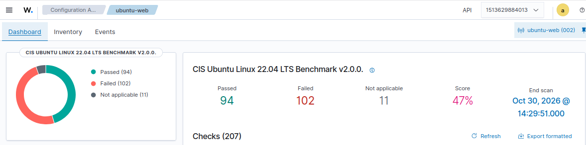</a></td></tr></table>

[Open original PNG](evidence/screenshots/057-ubuntu-sca-after-remediation.png)

<details>
<summary><strong>Supporting screenshots · Ubuntu SCA · check definitions, actual script and passing results</strong></summary>

**W2-054.** The policy excerpt identifies checks 28626 (/etc/crontab) and 28627 (/etc/cron.hourly), with neighboring checks.

<table width="900"><tr><td width="900" align="center"><a href="evidence/screenshots/054-ubuntu-sca-check-definitions.png">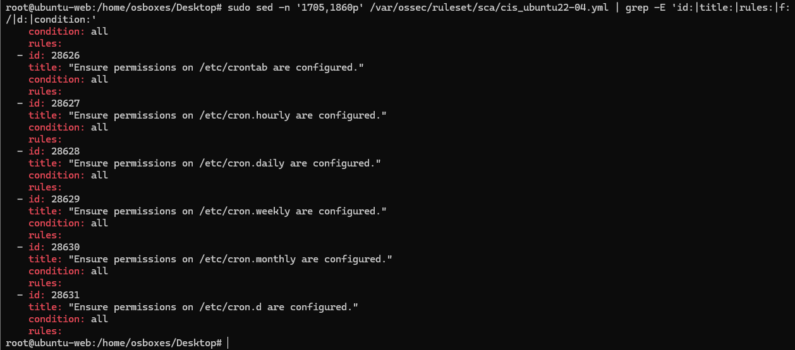</a></td></tr></table>

[Open original PNG](evidence/screenshots/054-ubuntu-sca-check-definitions.png)

**W2-055.** The captured script saves permission modes, changes root ownership and sets crontab 600 / cron.hourly 700. Before/after output is present.

<table width="900"><tr><td width="900" align="center"><a href="evidence/screenshots/055-ubuntu-sca-remediation-script.png">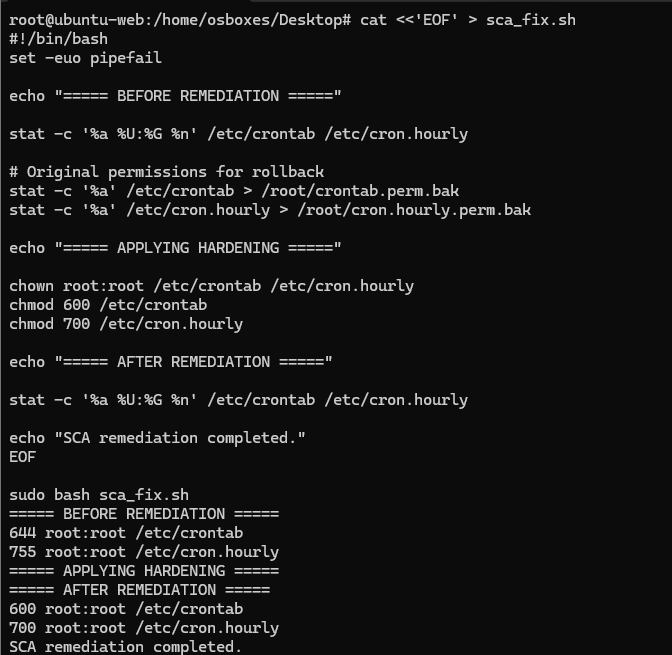</a></td></tr></table>

[Open original PNG](evidence/screenshots/055-ubuntu-sca-remediation-script.png)

**W2-056.** SCA event rows report the two permission checks as passed.

<table width="900"><tr><td width="900" align="center"><a href="evidence/screenshots/056-ubuntu-sca-passed-events.png">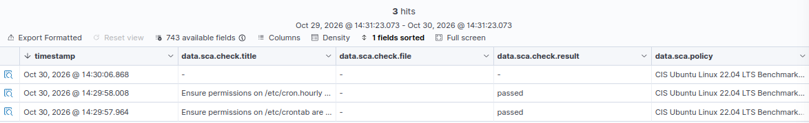</a></td></tr></table>

[Open original PNG](evidence/screenshots/056-ubuntu-sca-passed-events.png)

</details>

### Windows — password-history check 15500

Capture the baseline first:

```powershell
New-Item -ItemType Directory -Path 'C:\SCA-Lab' -Force | Out-Null
secedit /export /cfg C:\SCA-Lab\before.inf /areas SECURITYPOLICY
Select-String -Path C:\SCA-Lab\before.inf -Pattern 'PasswordHistorySize'
```

W2-058 shows `PasswordHistorySize = 0`. The recorded INF-based change is retained as [scripts/windows-sca-remediation.ps1](scripts/windows-sca-remediation.ps1):

```powershell
# Transcribed from WEEK2.docx image59. C:\SCA-Lab exists from the prior export.
# Review the local policy and preserve the before.inf export before running.
$dir = "C:\SCA-Lab"
$template = @"
[Unicode]
Unicode=yes
[Version]
signature="`$CHICAGO`$"
Revision=1
[System Access]
PasswordHistorySize = 24
"@

Set-Content -Path "$dir\fix.inf" -Value $template -Encoding Unicode
secedit /configure /db "$dir\fix.sdb" /cfg "$dir\fix.inf" /overwrite /areas SECURITYPOLICY /log "$dir\fix.log"
if ($LASTEXITCODE -ne 0) {
    throw "Security policy configuration failed. Check C:\SCA-Lab\fix.log"
}
secedit /export /cfg "$dir\after.inf" /areas SECURITYPOLICY
Select-String -Path "$dir\after.inf" -Pattern "PasswordHistorySize"
```

A separate effective-policy verification follows:

```powershell
secedit /export /cfg C:\SCA-Lab\verify.inf /areas SECURITYPOLICY
Select-String -Path C:\SCA-Lab\verify.inf -Pattern 'PasswordHistorySize'
```

<details>
<summary><code>New-Item</code> / initial <code>secedit /export</code></summary>

Creates the test workspace and preserves the effective baseline policy. `Out-Null` suppresses only the directory command output.

</details>

<details>
<summary>INF <code>[System Access]</code> / <code>PasswordHistorySize=24</code></summary>

Targets the reviewed local password-history setting. The escaped dollar signs preserve the literal `$CHICAGO$` INF signature inside PowerShell’s expandable here-string.

</details>

<details>
<summary><code>Set-Content -Encoding Unicode</code></summary>

Writes the policy template in the format used in the capture.

</details>

<details>
<summary><code>secedit /configure</code> / exit-code guard</summary>

Applies the reviewed template and writes a log. The captured command uses `/overwrite` on its dedicated fix.sdb; the shell reports success and exports the effective value. Review existing local/domain policy before replaying a security-policy change.

</details>

<details>
<summary><code>after.inf</code> / <code>verify.inf</code></summary>

Both exports show **24**. W2-060 reports check **15500** passed; W2-061 shows **118 passed / 301 failed / 5 N/A**, score **28%**.

</details>
<details>
<summary><strong>Windows SCA · initial value and applied template</strong></summary>

**W2-058.** secedit exports the initial local policy; PasswordHistorySize is 0.

<table width="900"><tr><td width="900" align="center"><a href="evidence/screenshots/058-windows-sca-before-policy.png"></a></td></tr></table>

[Open original PNG](evidence/screenshots/058-windows-sca-before-policy.png)

**W2-059.** An INF template sets PasswordHistorySize=24; secedit configures/exports it, and after.inf reports 24. Successful commands are visible.

<table width="900"><tr><td width="900" align="center"><a href="evidence/screenshots/059-windows-sca-remediation-script.png"></a></td></tr></table>

[Open original PNG](evidence/screenshots/059-windows-sca-remediation-script.png)

</details>
**W2-061.** Windows SCA summary changes to 118 passed, 301 failed, 5 not applicable; score 28%.

<table width="900"><tr><td width="900" align="center"><a href="evidence/screenshots/061-windows-sca-after-remediation.png"></a></td></tr></table>

[Open original PNG](evidence/screenshots/061-windows-sca-after-remediation.png)

<details>
<summary><strong>Supporting screenshots · Windows SCA · passing check, policy summary and independent export</strong></summary>

**W2-060.** SCA event row reports check 15500, Ensure Enforce password history is set to 24 or more passwords, as passed.

<table width="900"><tr><td width="900" align="center"><a href="evidence/screenshots/060-windows-sca-passed-event.png"></a></td></tr></table>

[Open original PNG](evidence/screenshots/060-windows-sca-passed-event.png)

**W2-062.** A separate verification export shows PasswordHistorySize=24 in verify.inf.

<table width="900"><tr><td width="900" align="center"><a href="evidence/screenshots/062-windows-sca-effective-policy.png"></a></td></tr></table>

[Open original PNG](evidence/screenshots/062-windows-sca-effective-policy.png)

</details>

No unrelated benchmark failures are marked fixed. A separate named failed check with an accepted deferral rationale is not supplied; record it if required for the assessment.


<a id="step-10"></a>

## 10. Vulnerability detection and inventory

**Run on:** Wazuh Dashboard; optional inspection on each endpoint

**Configuration / view:** Vulnerability Detection → selected agent → Critical filter

The captures are filtered to **Critical** and to one agent. Zero counts in other severity widgets in that filtered view do not establish that the machine has no lower-severity findings.

| Host | Filtered Critical entries | Recorded package / version | Visible example IDs |
| :--- | ---: | :--- | :--- |
| ubuntu-web | 103 | linux-image-6.8.0-138-generic · `6.8.0-138.138~22.04.1` | CVE-2026-98959, CVE-2026-97413 |
| win-client | 71 | Microsoft Windows 10 Enterprise · `10.0.19045.6456` | CVE-2026-96924, CVE-2026-85928, CVE-2026-85809 |

These are scanner-reported package/CVE associations, not independently verified exploits. The CVE examples above are transcribed from the displayed inventory; their advisory status and patch mapping were not independently researched in this documentation task.

The handoff reports these Ubuntu inspection commands:

```bash
uname -r
apt-cache policy linux-image-generic-hwe-22.04
```

**Handoff result:** running kernel `6.8.0-138-generic`, with candidate information recorded at the time. The package rows are captured, but the corresponding terminal outputs are not present in this DOCX. An available/installed candidate alone does not prove a reboot into a patched kernel.

<details>
<summary><code>uname -r</code></summary>

Checks the running kernel rather than only an installed package name. Its reported result is from the handoff; W2-065 shows package inventory.

</details>

<details>
<summary><code>apt-cache policy</code></summary>

Reads installed/candidate package metadata without applying updates. Confirm current vendor packages and advisories before deciding on remediation.

</details>

<details>
<summary>Patch acceptance</summary>

No kernel/Windows patch installation, reboot or post-remediation inventory clearing is demonstrated. SCA permission/password changes in the preceding section are separate controls, not CVE remediation.

</details>
<details>
<summary><strong>Critical-filter dashboard views</strong></summary>

**W2-063.** The filtered Windows dashboard displays 71 Critical findings. Other severity counts in this filtered view are not a whole-host vulnerability assessment.

<table width="900"><tr><td width="900" align="center"><a href="evidence/screenshots/063-windows-vulnerability-dashboard.png"></a></td></tr></table>

[Open original PNG](evidence/screenshots/063-windows-vulnerability-dashboard.png)

**W2-064.** The filtered Ubuntu dashboard displays 103 Critical findings.

<table width="900"><tr><td width="900" align="center"><a href="evidence/screenshots/064-ubuntu-vulnerability-dashboard.png"></a></td></tr></table>

[Open original PNG](evidence/screenshots/064-ubuntu-vulnerability-dashboard.png)

</details>
**W2-065.** Ubuntu critical inventory rows identify linux-image-6.8.0-138-generic and associated CVE entries. No patch/reboot/re-scan is shown.

<table width="900"><tr><td width="900" align="center"><a href="evidence/screenshots/065-ubuntu-vulnerability-inventory.png"></a></td></tr></table>

[Open original PNG](evidence/screenshots/065-ubuntu-vulnerability-inventory.png)

<details>
<summary><strong>Supporting screenshots · Package/CVE inventory and exact versions</strong></summary>

**W2-066.** Windows critical inventory lists Windows 10 Enterprise 10.0.19045.6456 and CVE entries; successful remediation is not established.

<table width="900"><tr><td width="900" align="center"><a href="evidence/screenshots/066-windows-vulnerability-inventory.png"></a></td></tr></table>

[Open original PNG](evidence/screenshots/066-windows-vulnerability-inventory.png)

</details>


<a id="step-11"></a>

## 11. Suricata installation and troubleshooting

**Run on:** ubuntu-web

**Configuration / view:** Temporary ens36 NAT/DNS; Suricata systemd service

### Temporary DNS repair — handoff-reported

Package installation initially failed because DNS on the temporary NAT adapter was not working. The handoff records this per-link repair:

```bash
sudo resolvectl dns ens36 8.8.8.8 1.1.1.1
sudo resolvectl domain ens36 '~.'
sudo resolvectl default-route ens36 yes
```

These settings belong to the temporary installation network. They are not evidence that final endpoint isolation was restored.

The captured installation command is:

```bash
sudo apt-get install suricata
```

The document narrative suggests the OISF stable PPA, but this capture does not prove the PPA was added. The actual running/tested version is **6.0.4**, confirmed by W2-072 and W2-074; do not describe it as the current latest release.

### Initial interface failure — handoff-reported

The original service targeted `eth0`, which did not exist. The handoff quotes:

```text
Failure when trying to get MTU via ioctl for 'eth0': No such device (19)
```

The DOCX contains the corrected `ens33` configuration and a running-service capture, not the failed-service log above. The following sections separate capture configuration from rule configuration.

<details>
<summary><code>resolvectl dns ens36</code></summary>

Sets DNS servers on the temporary NAT interface. This is reported execution context, not a command run against this cloud workspace.

</details>

<details>
<summary><code>domain ens36 ~.</code> / <code>default-route ens36 yes</code></summary>

Routes DNS lookups through that link while installing software. The exact handoff repair is retained; final adapter/remnant-policy cleanup remains a separate check.

</details>

<details>
<summary><code>apt-get install suricata</code></summary>

Installs the available Ubuntu package and dependencies. W2-067 shows the package transaction; its command is interactive and does not include `-y`.

</details>

<details>
<summary>The missing <code>eth0</code> issue</summary>

A nonexistent capture NIC prevents capture even when packages are installed. Resolve it using the actual `ip addr` interface, not by changing HOME_NET alone.

</details>
<details>
<summary><strong>Installation and corrected running service</strong></summary>

**W2-067.** APT installs Suricata and dependencies. PPA execution or a latest-release installation is not proved by this capture.

<table width="900"><tr><td width="900" align="center"><a href="evidence/screenshots/067-suricata-package-install.png"></a></td></tr></table>

[Open original PNG](evidence/screenshots/067-suricata-package-install.png)

**W2-068.** systemctl shows Suricata active (running) and enabled, with the AF_PACKET launch command. An earlier eth0 failure is not displayed here.

<table width="900"><tr><td width="900" align="center"><a href="evidence/screenshots/068-suricata-active-service.png"></a></td></tr></table>

[Open original PNG](evidence/screenshots/068-suricata-active-service.png)

</details>


<a id="step-12"></a>

## 12. AF_PACKET, HOME_NET and ruleset preparation

**Run on:** ubuntu-web

**Configuration / view:** `/etc/suricata/suricata.yaml`; host-only interface ens33

Inspect the actual interfaces:

```bash
ip addr
```

W2-069 shows **ens33 192.168.38.131/24** and temporary **ens36 192.168.121.157/24**. The latter is a dynamic NAT-side address and remains present in this capture.

Merge the observed capture settings into the existing YAML; retain its other configuration:

```yaml
# Observed portions of /etc/suricata/suricata.yaml (images70,71).
# Merge into existing vars / af-packet sections; keep the rest of the file.
vars:
  address-groups:
    HOME_NET: "[192.168.38.0/24]"
af-packet:
  - interface: ens33
    cluster-id: 99
    cluster-type: cluster_flow
```

The recorded ruleset tool invocation is:

```bash
sudo suricata-update
```

W2-072 identifies Suricata **6.0.4**, reads the YAML and reports its rules directories. The crop does not show a complete ET Open fetch summary. The custom rule and runtime alert are verified independently below.

<details>
<summary><code>af-packet.interface</code></summary>

Chooses the NIC where packets are captured: ens33. It sees packets delivered to that interface, not all traffic between unrelated machines on the virtual network.

</details>

<details>
<summary><code>cluster-id=99</code> / <code>cluster-type=cluster_flow</code></summary>

Retains the captured AF_PACKET fanout configuration. Flow-based distribution keeps packets of one flow together.

</details>

<details>
<summary><code>HOME_NET</code></summary>

Defines protected addresses for signatures that reference that variable. It does not choose the capture interface. The captured custom /admin rule uses the literal destination IP, not $HOME_NET.

</details>

<details>
<summary><code>suricata-update</code></summary>

Reads the Suricata version/config and manages rules. A tool-start screenshot is not proof that all external rules downloaded successfully.

</details>
**W2-070.** The AF_PACKET block selects ens33, cluster-id 99 and cluster-type cluster_flow.

<table width="900"><tr><td width="900" align="center"><a href="evidence/screenshots/070-suricata-af-packet-config.png"></a></td></tr></table>

[Open original PNG](evidence/screenshots/070-suricata-af-packet-config.png)

**W2-071.** HOME_NET is [192.168.38.0/24]. This controls rule variables, not NIC selection.

<table width="900"><tr><td width="900" align="center"><a href="evidence/screenshots/071-suricata-home-net-config.png"></a></td></tr></table>

[Open original PNG](evidence/screenshots/071-suricata-home-net-config.png)

<details>
<summary><strong>Supporting screenshots · Interfaces, AF_PACKET, HOME_NET and detected version</strong></summary>

**W2-069.** ubuntu-web has ens33 192.168.38.131/24 and a dynamic NAT-side ens36 address 192.168.121.157/24. Final endpoint isolation is not yet shown.

<table width="900"><tr><td width="900" align="center"><a href="evidence/screenshots/069-suricata-interface-addresses.png"></a></td></tr></table>

[Open original PNG](evidence/screenshots/069-suricata-interface-addresses.png)

**W2-072.** suricata-update detects version 6.0.4 and reads the configuration. Completion of the ET Open fetch is outside this crop.

<table width="900"><tr><td width="900" align="center"><a href="evidence/screenshots/072-suricata-update-version.png"></a></td></tr></table>

[Open original PNG](evidence/screenshots/072-suricata-update-version.png)

</details>


<a id="step-13"></a>

## 13. Custom HTTP /admin signature

**Run on:** ubuntu-web

**Configuration / view:** `/etc/suricata/rules/suricata.rules`; existing YAML rule-files list

The captured commands create the directory and display the resulting file:

```bash
sudo mkdir -p /etc/suricata/rules
sudo cat /etc/suricata/rules/suricata.rules
```

The exact rule is also retained as [config/labshop-admin.rules](config/labshop-admin.rules):

```suricata
alert http any any -> 192.168.38.131 any (msg:"LabShop Admin Page Probe"; flow:established,to_server; http.uri; content:"/admin"; sid:1000001; rev:1;)
```

The source does not show the editor/copy command or the effective YAML `rule-files` list. For a fresh replay, put the reviewed rule in that file and merge its absolute path into the **existing** list; the following loading entry is an explicit replay example, not a captured change:

```yaml
rule-files:
  - /etc/suricata/rules/suricata.rules
```

Keep any intended existing rule files. Do not create a duplicate top-level YAML key or overwrite an unrelated populated rule file.

The captured parser test is:

```bash
sudo suricata -T -c /etc/suricata/suricata.yaml
```

The handoff additionally reports verbose testing and service recovery:

```bash
sudo suricata -T -c /etc/suricata/suricata.yaml -v
sudo systemctl reset-failed suricata
sudo systemctl restart suricata
sudo systemctl status suricata --no-pager
sudo grep -iE '1000001|rule|error' /var/log/suricata/suricata.log | tail -n 15
```

**Captured result:** 6.0.4 reports “Configuration provided was successfully loaded. Exiting.” **Handoff result:** one rule file, one successfully loaded rule, zero failed rules; ens33 MTU 1500 and AFP capture threads running. Earlier “No rules loaded” entries were historical, preceding the custom file. Those detailed log lines are reported by the handoff, not recreated as screenshots.

<details>
<summary><code>alert http any any → 192.168.38.131 any</code></summary>

Alerts on HTTP from any source address/port to the recorded web endpoint. This is IDS observation, not an inline drop policy.

</details>

<details>
<summary><code>flow:established,to_server</code></summary>

Applies the rule to the client-to-server side of an established flow.

</details>

<details>
<summary><code>http.uri; content:"/admin"</code></summary>

Matches the HTTP URI substring. It can also match longer paths containing /admin; it is not an exact path authorization control and does not require a successful response.

</details>

<details>
<summary><code>sid:1000001; rev:1</code></summary>

Identifies this network signature and its revision. It is different from the Wazuh classification rule 86601.

</details>

<details>
<summary><code>suricata -T -c ...</code> / <code>-v</code></summary>

Tests YAML/rule loading without claiming live traffic detection. The verbose option requests more diagnostics.

</details>

<details>
<summary><code>reset-failed</code>, <code>restart</code>, <code>status</code></summary>

Clears the prior failed service state, starts the corrected setup and reads its effective runtime state. The handoff supplies these recovery commands; W2-068 records active/running.

</details>

<details>
<summary>Log grep / <code>tail -n 15</code></summary>

Looks at recent rule/error lines. Interpret timestamps so an old startup error is not presented as the current result.

</details>
**W2-073.** The custom HTTP rule targets 192.168.38.131, uses http.uri content /admin, and SID 1000001 rev 1.

<table width="900"><tr><td width="900" align="center"><a href="evidence/screenshots/073-suricata-admin-signature.png"></a></td></tr></table>

[Open original PNG](evidence/screenshots/073-suricata-admin-signature.png)

<details>
<summary><strong>Supporting screenshots · Signature body and successful configuration test</strong></summary>

**W2-074.** Suricata 6.0.4 reports configuration successfully loaded in -T test mode. Runtime delivery is checked separately.

<table width="900"><tr><td width="900" align="center"><a href="evidence/screenshots/074-suricata-config-test.png"></a></td></tr></table>

[Open original PNG](evidence/screenshots/074-suricata-config-test.png)

</details>


<a id="step-14"></a>

## 14. Validate Suricata from a second VM

**Run on:** win-client generates HTTP; ubuntu-web observes it

**Configuration / view:** ens33; `/var/log/suricata/{fast.log,eve.json,stats.log}`

The decisive request must enter the watched interface. A request from ubuntu-web to its own address may follow loopback, so the captured test uses Windows:

```powershell
curl.exe http://192.168.38.131/admin
```

On ubuntu-web, run the traffic observer in a separate terminal, stop it with Ctrl+C, then inspect the logs:

```bash
sudo tcpdump -ni ens33 'tcp port 80'
sudo tail -f /var/log/suricata/fast.log
sudo grep '1000001' /var/log/suricata/fast.log
sudo grep '"event_type":"http"' /var/log/suricata/eve.json | tail -n 3
sudo grep '"event_type":"alert"' /var/log/suricata/eve.json | tail -n 3
sudo grep -E '^decoder.pkts|^detect.alert|^app_layer.flow.http' /var/log/suricata/stats.log | tail -n 15
```

`tail -f` is also interactive; use a separate terminal or stop it before issuing the following inspection commands.

| Layer | Recorded result | Source |
| :--- | :--- | :--- |
| HTTP client | Apache 404 Not Found from /admin | W2-075 |
| NIC capture | .133 → .131:80, GET /admin and 404 response on ens33 | W2-076 |
| Structured HTTP record | event_type=http, URL /admin, status 404, curl/8.13.0 | W2-077 |
| Network alert | [1:1000001:1] LabShop Admin Page Probe | W2-078 |
| Local alert JSON / counters | Handoff reports matching alert JSON, detect.alert Total 1 and HTTP flow Total 1 | Handoff; terminal screenshots of these counters are absent |

The screenshot W2-077 is **an HTTP event, not the alert event**. The alert-type JSON is independently established in the later Wazuh event details (section 16). Do not substitute an Apache access-log alert for either result.

<details>
<summary><code>curl.exe</code></summary>

Uses the Windows curl executable rather than a PowerShell alias. The HTTP 404 is expected for the nonexistent page; the signature tests the request URI.

</details>

<details>
<summary><code>tcpdump -ni ens33</code></summary>

Independently observes packets on the selected interface without resolving addresses. The handoff reports nine captured packets and zero kernel drops; the supplied crop shows packet lines but not that summary.

</details>

<details>
<summary><code>fast.log</code></summary>

Provides short IDS alerts including the custom SID/revision. The visible match proves this signature fired, regardless of the 404 response.

</details>

<details>
<summary>Two EVE queries</summary>

Keeps HTTP metadata distinct from alert-type events. The source query for event_type=http is not mislabeled as an alert query.

</details>

<details>
<summary><code>stats.log</code> counters</summary>

Checks parser/detection activity. A counter alone does not prove a particular alert reached Wazuh, and these exact counter values are handoff-reported.

</details>
<details>
<summary><strong>Client request and ens33 packet path</strong></summary>

**W2-075.** Windows curl.exe requests /admin on ubuntu-web and receives an Apache 404 response.

<table width="900"><tr><td width="900" align="center"><a href="evidence/screenshots/075-suricata-windows-http-request.png"></a></td></tr></table>

[Open original PNG](evidence/screenshots/075-suricata-windows-http-request.png)

**W2-076.** tcpdump on ens33 observes Windows .133 to Ubuntu .131 TCP/80, GET /admin and the 404 response.

<table width="900"><tr><td width="900" align="center"><a href="evidence/screenshots/076-suricata-tcpdump-http-flow.png"></a></td></tr></table>

[Open original PNG](evidence/screenshots/076-suricata-tcpdump-http-flow.png)

</details>
**W2-078.** fast.log records [1:1000001:1] LabShop Admin Page Probe from .133 to .131:80.

<table width="900"><tr><td width="900" align="center"><a href="evidence/screenshots/078-suricata-fast-log-alert.png"></a></td></tr></table>

[Open original PNG](evidence/screenshots/078-suricata-fast-log-alert.png)

<details>
<summary><strong>Supporting screenshots · HTTP EVE metadata and the custom fast.log alert</strong></summary>

**W2-077.** The local EVE JSON query selects event_type=http, showing URL /admin and status 404. This is an HTTP record, not the alert-type proof.

<table width="900"><tr><td width="900" align="center"><a href="evidence/screenshots/077-suricata-eve-http-record.png"></a></td></tr></table>

[Open original PNG](evidence/screenshots/077-suricata-eve-http-record.png)

</details>


<a id="step-15"></a>

## 15. Forward Suricata EVE JSON to Wazuh

**Run on:** ubuntu-web

**Configuration / view:** Agent `/var/ossec/etc/ossec.conf` → localfile for EVE JSON

Merge the captured localfile entry inside the existing agent configuration:

```xml
<!-- Merge into the existing ossec_config on ubuntu-web (image79). -->
<localfile>
  <log_format>json</log_format>
  <location>/var/log/suricata/eve.json</location>
</localfile>
```

The handoff records reloading and checking the agent:

```bash
sudo systemctl restart wazuh-agent
sudo systemctl is-active wazuh-agent
```

After applying the collection entry, send a **new** request from win-client:

```powershell
curl.exe http://192.168.38.131/admin
```

<details>
<summary><code>log_format=json</code></summary>

Selects JSON log processing for EVE records. No additional custom application decoder is needed for this JSON input.

</details>

<details>
<summary><code>location</code></summary>

Points logcollector to /var/log/suricata/eve.json on ubuntu-web. This is a different source from /var/log/apache2/access.log.

</details>

<details>
<summary><code>restart</code> / <code>is-active</code></summary>

Reloads collection and checks agent state. The later EVE-origin dashboard record demonstrates actual delivery; a service-state check alone would not.

</details>

<details>
<summary>New Windows request</summary>

Creates a fresh appended record after collection is active. Do not assume an earlier local log entry was retroactively read or use two different requests to invent a pipeline-latency figure.

</details>
**W2-079.** The Wazuh agent localfile fragment reads /var/log/suricata/eve.json as json.

<table width="900"><tr><td width="900" align="center"><a href="evidence/screenshots/079-suricata-agent-eve-localfile.png"></a></td></tr></table>

[Open original PNG](evidence/screenshots/079-suricata-agent-eve-localfile.png)


<a id="step-16"></a>

## 16. Dashboard verification and remaining checks

**Run on:** Wazuh Dashboard; final service checks on each VM

**Configuration / view:** Expanded Suricata alert sourced from `/var/log/suricata/eve.json`

The updated document contains the required EVE-origin alert. Its final screenshots show these fields across one expanded event:

| Field | Recorded value |
| :--- | :--- |
| agent.name / agent.ip | ubuntu-web / 192.168.38.131 |
| location | /var/log/suricata/eve.json |
| decoder.name | json |
| data.event_type | alert |
| data.alert.signature_id / rev | 1000001 / 1 |
| data.alert.signature | LabShop Admin Page Probe |
| data.alert.action | allowed |
| data.in_iface | ens33 |
| data.src_ip / data.dest_ip | 192.168.38.133 / 192.168.38.131 |
| data.dest_port / data.http.url | 80 / /admin |
| rule.id / rule.level | **86601 / 3** |
| rule.groups | ids, suricata |
| rule.description | Suricata: Alert - LabShop Admin Page Probe |

Suricata's **1000001** is the custom network signature. Wazuh's **86601** is the built-in classification rule that received it. The user decided not to add Wazuh rule **100110**; no such deployment is claimed. `allowed` means IDS detection, not blocking.

<details>
<summary><strong>End-to-end EVE alert · event source and signature fields</strong></summary>

**W2-080.** The expanded Wazuh source contains event_type=alert, signature_id=1000001, LabShop Admin Page Probe, action=allowed, ens33, source .133 and destination .131.

<table width="900"><tr><td width="900" align="center"><a href="evidence/screenshots/080-suricata-wazuh-eve-alert.png"></a></td></tr></table>

[Open original PNG](evidence/screenshots/080-suricata-wazuh-eve-alert.png)

**W2-081.** Wazuh event detail identifies ubuntu-web, alert signature 1000001, app_proto=http and destination .131.

<table width="900"><tr><td width="900" align="center"><a href="evidence/screenshots/081-suricata-wazuh-signature-fields.png"></a></td></tr></table>

[Open original PNG](evidence/screenshots/081-suricata-wazuh-signature-fields.png)

</details>
**W2-082.** The event detail retains event_type=alert, GET and HTTP URL /admin, with flow fields.

<table width="900"><tr><td width="900" align="center"><a href="evidence/screenshots/082-suricata-wazuh-http-fields.png"></a></td></tr></table>

[Open original PNG](evidence/screenshots/082-suricata-wazuh-http-fields.png)

**W2-083.** Wazuh detail shows decoder=json, location=/var/log/suricata/eve.json, groups ids/suricata, rule 86601 and level 3. This is the EVE-origin proof, not an Apache access-log alert.

<table width="900"><tr><td width="900" align="center"><a href="evidence/screenshots/083-suricata-wazuh-rule-86601.png"></a></td></tr></table>

[Open original PNG](evidence/screenshots/083-suricata-wazuh-rule-86601.png)

The earlier local HTTP event is around 20:08, while this collected alert is around 20:17 after a new request. These are separate test requests, not a measured nine-minute delivery delay. The earlier 23-page source described in the handoff ended with an Apache alert; the supplied 25-page file contains the correct Suricata details above.

### Final operational checks — verification procedure, not completed reboot evidence

On ubuntu-web:

```bash
systemctl is-enabled suricata wazuh-agent chrony
systemctl is-active suricata wazuh-agent chrony
chronyc sources -n
ip route
```

On siem-host:

```bash
systemctl is-enabled chrony
chronyc tracking
sudo ss -lunp | grep ':123'
```

On win-client:

```powershell
w32tm /query /source
w32tm /query /status
```

<details>
<summary><code>is-enabled</code> / <code>is-active</code></summary>

Checks boot configuration and current state separately. Repeat after an actual reboot and retain the output before marking persistence complete.

</details>

<details>
<summary>Clock queries / UDP listener</summary>

Checks the effective server and source selection after restart/reboot. Baku local time alone is insufficient; sustained frequency/dispersion issues remain open.

</details>

<details>
<summary><code>ip route</code></summary>

Checks effective routes, not just VMware adapter labels. ens36 NAT is present in W2-069; retain its actual removal/final isolation evidence.

</details>

<details>
<summary>Acceptance scope</summary>

The repository checks validate documentation, assets and configuration structure. They do not deploy software, execute these VM commands or verify unprovided test outcomes.

</details>

Remaining work is listed in the [acceptance matrix](docs/acceptance.md): isolated negative-case retests, scheduled-FIM interval restoration, exact timing if needed, long-term time stability, post-reboot persistence, final NAT isolation and evidence of any claimed CVE remediation. The [journal](journal.md) keeps the actual failures and corrections.


---

[All days](../../README.md) · [Day 01 and NTP](../day-01/README.md#ntp-time-synchronization) · [Evidence register](evidence/README.md) · [Configuration files](config/README.md) · [Journal](journal.md) · [Acceptance](docs/acceptance.md)

Prepared by Roman Rzayev.
