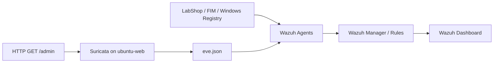

# Day 02 · Detection Engineering, FIM, SCA & Suricata

**Roman Rzayev** · Wazuh 4.14.7 · Ubuntu 22.04 · Windows 10 · Suricata 6.0.4

This walkthrough continues [Day 01](../day-01/README.md). Every command below states **where** it runs and **why**. The results are based on the supplied 25-page `WEEK2(1).docx` evidence set; unobserved checks are explicitly marked pending.

| Lab machine | IP | Role |
| :--- | :--- | :--- |
| `siem-host` | `192.168.38.132` | Docker-based Wazuh Manager, NTP server |
| `ubuntu-web` | `192.168.38.131` | Apache, Linux Wazuh agent, Suricata IDS |
| `win-client` | `192.168.38.133` | Windows Wazuh agent, FIM/Registry testing |

**Start with [time synchronization at the very beginning of Day 01](../day-01/README.md#ntp-time-synchronization).** A uniform timezone is not the same as a synchronized clock.

## Workflow



| Stage | Evidence-based result |
| :--- | :--- |
| LabShop failed-login decoding | PASS · Rule `100100`, level 5 |
| Same-IP brute-force correlation | PASS · Rule `100101`, level 10; 5 matches in 60 seconds |
| Negative/malformed test cases | Recorded |
| Linux and Windows FIM | Create / modify / delete recorded |
| Windows registry FIM | Value modification recorded |
| Scheduled `/etc` FIM | Test with temporary 60-second interval recorded |
| Ubuntu SCA remediation | 92→94 passed, 104→102 failed |
| Windows SCA remediation | 117→118 passed, 302→301 failed |
| Vulnerability inventory | Recorded; remediation of listed CVEs **not established** |
| Suricata HTTP `/admin` signature | PASS · SID `1000001` |
| Suricata → Wazuh alert | PASS · built-in Wazuh rule `86601`, level 3 |
| Post-reboot service persistence | **Pending direct reboot proof** |

> **Screenshots:** The 83 original screenshots from the DOCX are preserved in the downloadable evidence bundle prepared with this documentation. Binary images are not yet confirmed in this GitHub folder; avoid claiming they are uploaded until checked.

<a id="step-01"></a>
## 1. LabShop log ingestion — ubuntu-web

The app writes syslog-style events to `/var/log/labshop/app.log`. Inspect the actual format before creating decoders.

```bash
sudo tail -n 5 /var/log/labshop/app.log
sudo grep -n -A 4 'labshop/app.log' /var/ossec/etc/ossec.conf
```

<details><summary>Command explanations</summary>

- `tail -n 5`: shows five recent raw application messages and verifies the source file exists.
- `grep ... ossec.conf`: checks that the Linux Wazuh agent collects this exact file in `syslog` format.

</details>

The agent configuration includes this `localfile` entry:

```xml
<localfile>
  <log_format>syslog</log_format>
  <location>/var/log/labshop/app.log</location>
</localfile>
```

<details><summary>Configuration explanation</summary>

`localfile` registers the source; `log_format=syslog` allows Wazuh's syslog predecoder to identify the `labshop` program name. The `location` is the Linux endpoint's path, not the manager container's path.

</details>

<a id="step-02"></a>
## 2. LabShop custom decoders — siem-host / Wazuh Manager container

```bash
sudo docker exec -it single-node-wazuh.manager-1 bash
cat /var/ossec/etc/decoders/labshop_decoders.xml
```

The recorded decoder extracts `action`, `dstuser` and `srcip` from a line shaped like `LOGIN_FAILED user=admin src=192.168.38.133`.

```xml
<decoder name="labshop">
  <program_name>^labshop$</program_name>
</decoder>
<decoder name="labshop-login">
  <parent>labshop</parent>
  <regex>^(\S+) user=(\S+) src=(\S+)</regex>
  <order>action,dstuser,srcip</order>
</decoder>
```

<details><summary>Decoder explanation</summary>

- `program_name` limits the parent decoder to `labshop` syslog messages.
- `parent` links the child parser to that message family.
- `regex` extracts the event action, username and source address.
- `order` maps captures into Wazuh fields. The action is a built-in static field and is matched using `<action>` in the rule, **not** `<field name="action">`.

</details>

**Validation:**

```bash
/var/ossec/bin/wazuh-logtest
```

Paste a genuine `labshop` log line and check Phase 2 decoding and Phase 3 rule matching. Exit the interactive test with Ctrl+C.

<a id="step-03"></a>
## 3. LabShop detection rules — Wazuh Manager container

The implemented rules are stored in `/var/ossec/etc/rules/labshop_rules.xml`:

```xml
<group name="labshop,">
  <rule id="100100" level="5">
    <decoded_as>labshop</decoded_as>
    <action>LOGIN_FAILED</action>
    <user negate="yes">^monitor$</user>
    <description>LabShop: failed login to the shop application.</description>
    <group>authentication_failed,</group>
  </rule>

  <rule id="100101" level="10" frequency="5" timeframe="60">
    <if_matched_sid>100100</if_matched_sid>
    <same_srcip />
    <description>LabShop: brute force, 5 failed logins from the same IP within 60 seconds.</description>
    <group>authentication_failures,</group>
  </rule>
</group>
```

<details><summary>Why each rule condition matters</summary>

- `100100` signals a single failed login at level 5.
- `LOGIN_FAILED` ensures successful logins do not trigger the failure alert.
- `user negate="yes"` excludes the monitoring account from this detector.
- `100101`, `frequency=5`, `timeframe=60`: correlates repeated failed-login alerts.
- `same_srcip`: requires the correlated failures to originate from the same IP; do not combine failures across unrelated sources.

</details>

```bash
/var/ossec/bin/wazuh-analysisd -t
```

<details><summary>Test command explanation</summary>

Checks the manager's rule/decoder configuration syntax before a restart. A successful test alone does not demonstrate the intended alert: use `wazuh-logtest` and a dashboard event as well.

</details>

**Regression note:** Week 1 Sysmon IDs originally overlapped this block. They were moved to `100200–100203`. Keep IDs unique.

<a id="step-04"></a>
## 4. LabShop six-case validation

**Run on:** ubuntu-web, then verify results in Wazuh Dashboard and/or `wazuh-logtest`.

```bash
./labshop_gen.sh fail admin 192.168.38.133 1
./labshop_gen.sh fail admin 192.168.38.133 6
./labshop_gen.sh fail monitor 10.10.10.1 3
./labshop_gen.sh fail admin 10.10.10.50 3
./labshop_gen.sh fail admin 10.10.10.60 3
./labshop_gen.sh ok alice 10.10.10.50 2
```

<details><summary>What the test arguments do</summary>

`fail` or `ok` selects the simulated login outcome; the following values identify the account, source IP and number of generated messages. Validate negative cases with fresh test windows to avoid contaminating the brute-force correlation with earlier failures. The original six-test set also included an intentionally malformed log line.

</details>

| Case | Intended result | Recorded outcome |
| :--- | :--- | :--- |
| One failure | `100100` | PASS |
| Repeated same-source failure | `100101` | PASS |
| `monitor` exclusion | No LabShop custom alert | PASS |
| Failures split across two addresses | No cross-source aggregation | Recorded; screenshot context should be reviewed |
| `LOGIN_OK` | No failure detector | PASS |
| Malformed message | No custom LabShop match | PASS |

<a id="step-05"></a>
## 5. Linux real-time File Integrity Monitoring

**Run on:** ubuntu-web. Configure the Linux agent's `/var/ossec/etc/ossec.conf`:

```xml
<directories check_all="yes" realtime="yes" report_changes="yes">/var/www/html</directories>
```

```bash
sudo systemctl restart wazuh-agent
sudo touch /var/www/html/fim-test
echo "Modified Content" | sudo tee /var/www/html/fim-test
sudo rm /var/www/html/fim-test
```

<details><summary>Configuration and commands explained</summary>

- `check_all`: enable available integrity checks (metadata and hashes).
- `realtime=yes`: rely on inotify-style event detection rather than waiting for periodic scans.
- `report_changes=yes`: request a content diff where supported and permitted.
- `touch`: file created; `tee`: contents modified; `rm`: file deleted.
- `systemctl restart`: reload the agent configuration.

</details>

**Observed:** Wazuh displayed file-added, integrity-changed and file-deleted events for the test path.

<a id="step-06"></a>
## 6. Windows file and registry monitoring

**Run on:** win-client; edit `C:\Program Files (x86)\ossec-agent\ossec.conf` with administrative permissions.

```xml
<directories check_all="yes" realtime="yes" report_changes="yes">C:\LabShopData</directories>
<windows_registry arch="both" report_changes="yes">HKEY_LOCAL_MACHINE\SOFTWARE\LabShop</windows_registry>
```

**Run on:** elevated PowerShell:

```powershell
Set-Content -Path 'C:\LabShopData\test.txt' -Value 'Original LabShop Data'
Add-Content -Path 'C:\LabShopData\test.txt' -Value 'Modified LabShop Data'
Remove-Item -Path 'C:\LabShopData\test.txt'
Set-ItemProperty -Path 'HKLM:\SOFTWARE\LabShop' -Name 'Environment' -Value 'Development'
```

<details><summary>Why these commands matter</summary>

- `Set-Content`: creates the file.
- `Add-Content`: changes the existing file.
- `Remove-Item`: deletes the file.
- `Set-ItemProperty`: changes a Windows Registry value so registry FIM can detect the modification.
- `arch=both`: monitors relevant 32-bit/64-bit registry views where applicable.
- The test directory and registry key must exist or be prepared first, as recorded in the source lab.

</details>

**Observed:** Windows agent produced file create/modify/delete alerts and Registry `LabShop` value-modification alerts in Wazuh.

<a id="step-07"></a>
## 7. Linux scheduled FIM and timing comparison

**Run on:** ubuntu-web. The default scheduled scan interval was **43200 seconds (12 hours)**. For a controlled test, a **temporary 60-second** scan was used.

```xml
<frequency>60</frequency>
<directories>/etc</directories>
```

```bash
echo "Original FIM Content" | sudo tee /etc/labshop-fim-test.txt
date '+%Y-%m-%d %H:%M:%S'
echo "Scheduled FIM Modification Test" | sudo tee -a /etc/labshop-fim-test.txt
sudo grep 'File integrity monitoring scan frequency' /var/ossec/logs/ossec.log | tail -n 1
```

<details><summary>Why timing is different</summary>

Realtime FIM generates events promptly after filesystem notifications. Scheduled FIM discovers changes only on a scan, so observed latency depends on when a modification occurs relative to the next scan. The source shows a 60-second test setting and dashboard events, **not a sufficiently controlled precise latency comparison**; avoid inventing millisecond/second averages.

</details>

**Restore production-style interval after test:** edit the original agent configuration to use `<frequency>43200</frequency>` and restart `wazuh-agent`. Verify it actually reverted before claiming the original interval is restored.

<a id="step-08"></a>
## 8. Security Configuration Assessment (SCA)

The recorded baseline checks were:

| Agent | Policy | Before | After demonstrated change |
| :--- | :--- | :--- | :--- |
| ubuntu-web | CIS Ubuntu Linux 22.04 LTS | 92 passed, 104 failed, 11 N/A · 46% | 94 passed, 102 failed, 11 N/A · 47% |
| win-client | CIS Windows 10 Enterprise | 117 passed, 302 failed, 5 N/A · 27% | 118 passed, 301 failed, 5 N/A · 28% |

**Ubuntu remediation (IDs `28626`, `28627`):**

```bash
stat -c '%a %U:%G %n' /etc/crontab /etc/cron.hourly
sudo chown root:root /etc/crontab /etc/cron.hourly
sudo chmod 600 /etc/crontab
sudo chmod 700 /etc/cron.hourly
stat -c '%a %U:%G %n' /etc/crontab /etc/cron.hourly
```

<details><summary>Ubuntu commands explained</summary>

`stat` records permissions and ownership before/after. `chown` sets root ownership. `chmod 600` restricts crontab read/write to owner; `chmod 700` restricts the hourly cron directory to root. Wazuh's following SCA scan confirmed two failed checks turned PASS.

</details>

**Windows remediation (ID `15500`):** the local security policy's `PasswordHistorySize` was changed from `0` to `24` using `secedit`. Check the effective policy, rather than assuming a successful process exit means the SCA check passed.

```powershell
New-Item -ItemType Directory -Path 'C:\SCA-Lab' -Force | Out-Null
secedit /export /cfg C:\SCA-Lab\verify.inf /areas SECURITYPOLICY
Select-String -Path C:\SCA-Lab\verify.inf -Pattern 'PasswordHistorySize'
```

<details><summary>Windows verification explained</summary>

`secedit /export` writes the effective local security-policy values into a reviewable INF file. `Select-String` looks up password history. The captured post-change value is `PasswordHistorySize = 24`. This does not by itself mean every Windows benchmark check is passing.

</details>

A third intentionally unremediated SCA failure and its risk-based rationale should be recorded before final acceptance.

<a id="step-09"></a>
## 9. Vulnerability detection and triage

**Run on:** Wazuh Dashboard → Vulnerability Detection → Dashboard / Inventory.

| Machine | Recorded critical findings | Example affected component |
| :--- | ---: | :--- |
| win-client | 71 | Windows 10 Enterprise |
| ubuntu-web | 103 | `linux-image-6.8.0-138-generic` |

These are **inventory findings**, not 174 verified exploitable incidents. Counts can include multiple CVEs mapped to versions. The source captures do not show successful patch installation or rescanning that clears them.

**On ubuntu-web, inspect the candidate:**

```bash
uname -r
apt-cache policy linux-image-generic-hwe-22.04
```

<details><summary>Why these checks are needed</summary>

`uname -r` reads the running kernel; `apt-cache policy` compares installed and repository candidate versions. A kernel update requires reboot and validation before claiming a CVE remediated. Do not blindly install an unverified version.

</details>

**On win-client, review installed system build:**

```powershell
Get-ComputerInfo | Select-Object WindowsProductName, OsVersion, OsBuildNumber
Get-HotFix | Sort-Object InstalledOn -Descending | Select-Object -First 10
```

<details><summary>Windows checks explained</summary>

The first command reports the actual OS and build; the second lists recent installed hotfixes. Cross-check against the vendor's current supported release and the CVE's official advisory before calling the machine patched.

</details>

<a id="step-10"></a>
## 10. Suricata installation, AF_PACKET and HOME_NET

**Run on:** ubuntu-web.

```bash
sudo apt-get update
sudo apt-get install -y suricata
ip -br addr
sudo grep -n -A 4 '^af-packet:' /etc/suricata/suricata.yaml
```

<details><summary>Command explanations</summary>

- `apt-get update`: refresh available package metadata.
- `apt-get install`: installs Suricata IDS and related tools.
- `ip -br addr`: verifies that `ens33` is the real host-only interface.
- `grep`: reads the capture-interface configuration without changing it.

</details>

Configured Suricata 6.0.4 using:

```yaml
vars:
  address-groups:
    HOME_NET: "[192.168.38.0/24]"
af-packet:
  - interface: ens33
```

<details><summary>AF_PACKET versus HOME_NET</summary>

`AF_PACKET` defines **where** Suricata captures visible packets (`ens33`). `HOME_NET` is a **rule variable** defining the protected network. Changing `HOME_NET` does not change the NIC being sniffed. A NIC sees only traffic actually delivered to it; it is not automatically a tap for all traffic among other peers.

</details>

**Troubleshooting recorded:** Suricata initially targeted `eth0`, which did not exist. Changing the AF_PACKET interface to `ens33` fixed that startup error.

<a id="step-11"></a>
## 11. Custom HTTP /admin signature

**Run on:** ubuntu-web.

```bash
sudo mkdir -p /etc/suricata/rules
sudo tee /etc/suricata/rules/suricata.rules >/dev/null <<'EOF'
alert http any any -> 192.168.38.131 any (msg:"LabShop Admin Page Probe"; flow:established,to_server; http.uri; content:"/admin"; sid:1000001; rev:1;)
EOF
sudo suricata -T -c /etc/suricata/suricata.yaml
```

<details><summary>Signature explained</summary>

- `alert http`: produce an IDS alert on matching HTTP transactions.
- `any any -> 192.168.38.131 any`: any source to the Ubuntu web server.
- `flow:established,to_server`: inspect an established client-to-server request.
- `http.uri`: inspect the HTTP URI field.
- `content:"/admin"`: match the substring, including paths such as `/admin/login`.
- `sid:1000001; rev:1`: unique custom signature ID and revision.
- `suricata -T`: parse the Suricata configuration and rules before changing the service.

</details>

```bash
sudo systemctl enable --now suricata
sudo systemctl restart suricata
sudo systemctl is-active suricata
```

<details><summary>Service commands explained</summary>

`enable --now` configures automatic service startup and starts it immediately; `restart` reloads the detection rule. `is-active` reads the current state; a post-reboot run is still needed to demonstrate persistence.

</details>

<a id="step-12"></a>
## 12. Windows-origin HTTP test and Suricata logs

**Run on:** win-client, PowerShell:

```powershell
curl.exe http://192.168.38.131/admin
```

**Run on:** ubuntu-web in a separate terminal:

```bash
sudo tcpdump -ni ens33 'tcp port 80'
sudo grep '1000001' /var/log/suricata/fast.log
sudo grep '"event_type":"alert"' /var/log/suricata/eve.json | tail -n 3
```

<details><summary>Verification explained</summary>

- `curl.exe`: sends an HTTP GET from a second VM so packets enter the watched `ens33` adapter.
- `tcpdump`: independently proves `ens33` receives `GET /admin` (stop with Ctrl+C).
- `fast.log`: shows the short alert `[1:1000001:1] LabShop Admin Page Probe`.
- `eve.json`: stores structured alert fields for the SIEM pipeline.
- The observed HTTP response was **404 Not Found**. Detection still succeeds because the signature inspects the request URI, not response success.

</details>

<a id="step-13"></a>
## 13. Wazuh Suricata integration

**Run on:** ubuntu-web; add to `/var/ossec/etc/ossec.conf`:

```xml
<localfile>
  <log_format>json</log_format>
  <location>/var/log/suricata/eve.json</location>
</localfile>
```

```bash
sudo systemctl restart wazuh-agent
sudo systemctl is-active wazuh-agent
```

<details><summary>Why these are necessary</summary>

The Wazuh agent's `logcollector` reads appended JSON records and forwards them to the manager. Restart reloads `ossec.conf`. Reissue the request after setup because earlier logs may not be retroactively collected.

</details>

After a **new** Windows `curl.exe .../admin`, Wazuh Dashboard shows:

| Field | Observed value |
| :--- | :--- |
| `location` | `/var/log/suricata/eve.json` |
| `data.event_type` | `alert` |
| `data.alert.signature_id` | `1000001` |
| `data.alert.signature` | `LabShop Admin Page Probe` |
| `data.http.url` | `/admin` |
| `data.src_ip` | `192.168.38.133` |
| `data.dest_ip` | `192.168.38.131` |
| `rule.id` | `86601` |
| `rule.level` | `3` |

**Interpretation:** Suricata's **custom network signature** creates the alert; Wazuh's **built-in** `86601` rule classifies it. No additional Wazuh `100110` rule was needed for ingestion. `data.alert.action=allowed` means IDS detection only — traffic was not blocked.

<a id="step-14"></a>
## 14. Persistence, isolation and remaining checks

**Run on:** ubuntu-web:

```bash
systemctl is-enabled suricata wazuh-agent chrony
systemctl is-active suricata wazuh-agent chrony
chronyc sources -n
ip route
```

**Run on:** siem-host:

```bash
systemctl is-enabled chrony
chronyc tracking
sudo ss -lunp | grep ':123'
```

**Run on:** win-client:

```powershell
w32tm /query /source
w32tm /query /status
```

<details><summary>Why final checks are important</summary>

- `is-enabled` shows boot-start configuration; only an actual reboot plus validation proves it works afterwards.
- `is-active` checks the running service.
- `chronyc` and `w32tm` check that both endpoints actually use `192.168.38.132` (not only the same timezone).
- `ip route` checks that temporary endpoint NAT has truly been removed. The documented Suricata capture still showed `ens36` NAT, so final isolation is pending.
- Both Linux VMs showed unusually high Chrony frequency correction (~12755 ppm); check VMware guest time synchronization and sustained drift before treating long-term time stability as resolved.

</details>

**Source-to-document integrity:** commands are reconstructed from the attached screenshots and the lab conversation; explanations do not imply the assistants remotely executed any commands. Store live secrets, hashes and actual production security configurations outside the public repository.

See also [Week 2 journal](journal.md) and [Week 2 acceptance matrix](docs/acceptance.md).
