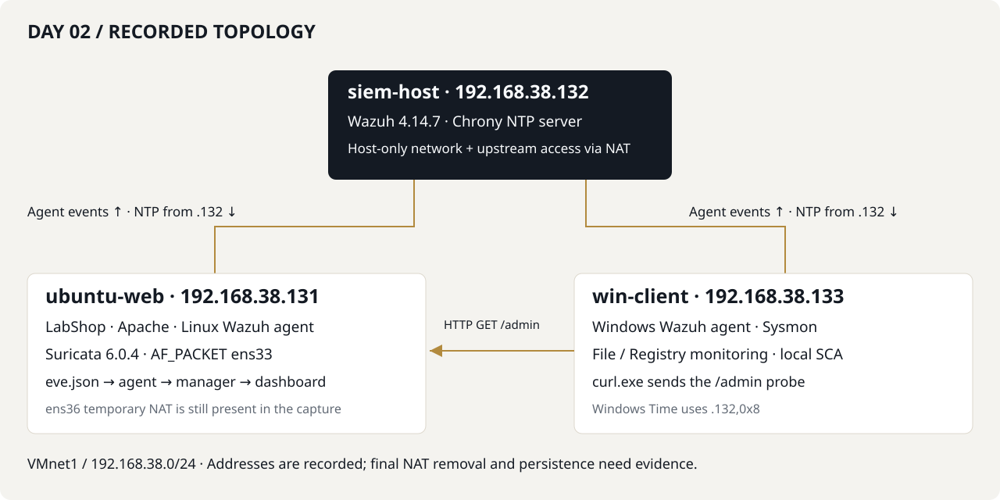

# Day 02 architecture

| System | Address | Recorded roles |
| :--- | :--- | :--- |
| siem-host | 192.168.38.132 | Wazuh 4.14.7 manager/indexer/dashboard, internal Chrony NTP server |
| ubuntu-web | 192.168.38.131 | LabShop, Apache, Linux agent, Suricata 6.0.4 on ens33 |
| win-client | 192.168.38.133 | Windows agent/Sysmon, files/Registry/SCA, HTTP test client |

W2-069 also shows ubuntu-web ens36 at 192.168.121.157/24. It was used for temporary installation access; final removal is not captured. HOME_NET is a rule variable, not capture-interface selection. The custom signature uses the literal .131 destination.

Time-service traffic uses UDP/123. Captured agents forward configured local logs; Suricata is a passive IDS in this setup, not a demonstrated inline firewall. [Day 01 NTP](../../day-01/README.md#ntp-time-synchronization) contains clock source and drift evidence.

[Back to walkthrough](../README.md)
